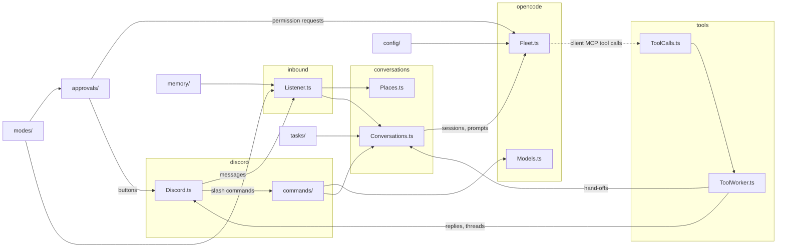

# AGENTS.md

Wendell is a Discord bot that connects to running OpenCode servers and joins conversations when he can help. The most important quality is that he feels natural to talk to.

## Toolchain

- Bun. `effect` is pinned to `4.1.0` because `@opencode/client` pins it. Keep one copy of `effect` in `node_modules`. Read `node_modules/effect/ai-docs` and the `.d.ts` files before you guess an API.
- `bun run check` (typecheck and lint) must pass before you finish.
- Follow the Effect skill in `.agents/skills/effect/` (vendored from `kitlangton/skills`). Read its branch references before you change services, schemas or streams.
- `bun run lint` runs oxlint with the vendored anti-slop rules in `tools/oxlint/anti-slop/` (from `dmmulroy/anti-slop`). `bun run lint -- --fix` fixes blank-line spacing. Fix the code, never the rules.

## Tests

- Do not write tests. Tests written together with the code only check that the code does what it was written to do.
- Verify changes by running Wendell against a real OpenCode server instead, for example with a throwaway script in `.data/` (ignored by Git) that fakes only Discord. Delete the script and the sessions it created when you finish.
- The user adds tests themselves for business-critical logic.

## Git

- Commit and push to `origin main` when a feature is done and `bun run check` passes. Use short, conventional commit messages (`feat:`, `fix:`, `docs:`, `chore:`).
- Never commit `.env`, `wendell.json` or anything in `.data/`.

## Effect conventions

- Services use the module namespace style. `X.ts` exports `interface Interface`, `class Service extends Context.Service<Service, Interface>()("wendell/X")` and `layer`, and ends with `export * as X from "./X.ts"`. Consumers `import { X } from "./X.ts"`.
- Records: `Schema.Struct(...)` plus a same-name `interface`. Errors: `Schema.TaggedError`.
- Internal states: `Data.taggedEnum`. Branch with `$match` or `$is`, never `_tag ===`.
- Service methods: `Effect.fn("X.method")`.
- Config: `Config.*` in layers. Do not read `process.env`.
- No `as` casts, `any` or non-null assertions.

## Architecture

`src/` has one folder for each area. `main.ts` only connects the layers.

Where to find things:

| Folder | What it does |
| --- | --- |
| `cli/` | `bun run doctor`, `pair` and `unpair`. |
| `config/` | Environment settings (`Settings.ts`), `wendell.json` (`WendellConfig.ts`), paired servers (`Servers.ts`, `.data/servers.json`) and pairing links. |
| `shared/` | IDs, `JsonStore.ts` (one JSON file in `.data/`, read at startup, written after each change), text escaping and file name helpers. |
| `discord/` | The Discord adapter. `Discord.ts` is the service and the only module that talks to Discord (dfx). Its parts: `Messages.ts`, `Interactions.ts`, `Identity.ts` (profile and presence) and `Payloads.ts` (gateway payloads to Wendell's types). Also `Embeds.ts`, `Presence.ts` and `Profile.ts` (the kept presence). |
| `discord/commands/` | One module for each slash command. `Command.ts` is the shape of a command, `Commands.ts` registers and answers them. |
| `inbound/` | Incoming messages: `Listener.ts` routes (`Routing.ts`), screens (`Screen.ts`), batches per channel and delivers. `Inbound.ts` renders messages for the prompt. `Attachments.ts` saves incoming files, `Recent.ts` keeps recent messages for tools. |
| `conversations/` | `Conversations.ts` delivers prompts. `Sessions.ts` creates and prepares sessions, `Briefing.ts` builds the context entry, `TurnWatcher.ts` follows turns. `Places.ts` finds the conversation of a message. `Activity.ts` records when Wendell spoke. |
| `opencode/` | `Fleet.ts` (servers, files, worktrees, client MCP), `Models.ts`, `Policy.ts` (session permissions), `SessionKey.ts`, `Decisions.ts` (the decision model). |
| `tools/` | Wendell's Discord tools. `ClientTools.ts` has the schemas, `ToolCalls.ts` the queue, `ToolWorker.ts` sends each call to its handler in `handlers/`. `Uploads.ts` reads files for replies. |
| `transcription/` | Voice messages: `Transcriber.ts`, the provider contract (`Provider.ts`), the provider choice (`SpeechToText.ts`) and the providers (`CommandProvider.ts`, `OpenAIProvider.ts`). |
| `tasks/` | Task threads and sub-tasks (`.data/tasks.json`). |
| `approvals/` | Permission requests (`Approvals.ts`) and the reviewer (`Reviewer.ts`). |
| `modes/` | Per-conversation settings: `ConversationSetting.ts`, used by `ApprovalModes.ts` (`/auto`) and `BusyModes.ts` (`/busy`). |
| `memory/` | Notes about people and servers (`Memory.ts`), their capture in the background (`Capture.ts`) and what goes in front of each batch (`Recollection.ts`). |

Details:

- `Listener.ts` routes each message (`Routing.ts`), screens ambient messages (`Screen.ts`), batches per channel and delivers to the conversation (`Conversations.ts`).
- `Places.ts` decides where a message's conversation lives: a channel, a task thread (`Tasks.ts`) or a DM, and on which server.
- `Conversations.ts` delivers prompts. `Sessions.ts` owns sessions and their context entries (`Briefing.ts`). `TurnWatcher.ts` follows each turn (👀, typing, status line, error and silence fallbacks). It also follows turns that Wendell did not start (a fired schedule, an `image_generate` notice): it records the inbox IDs of Wendell's own prompts, and watches each other delivery to a root session that has no active watcher. These turns get no 👀, no status line and no silence fallback, but errors are posted. At startup `Conversations.ts` attaches the client MCP tools to every known directory (tasks and `dm-*`), so a schedule can post after a restart.
- `Attachments.ts` saves incoming Discord attachments on the server (`attachments/<message id>/<safe name>`, 25 MB limit, through `Fleet.writeFile`, never on the local disk). `Uploads.ts` reads outgoing files for `wendell_reply` (`Fleet.readFile`). Outgoing files must be in the conversation's directory, its tasks' directories or the server's tmp directory, and never `.env` (`Policy.isSecretFile`). Images go to the model as `file://` prompt attachments.
- Records in `.data/` use `JsonStore.ts`. It fails at startup when a file is broken, so a broken file is never overwritten. `Activity.ts` uses `JsonStore.makeOrReset`, because its data is cheap to lose. `Servers.ts` reads its file on each call, because `bun run pair` changes it from another process.
- `Profile.ts` keeps Wendell's presence (status and activity, `.data/profile.json`) and sends it again on every gateway `READY`, because Discord forgets it on reconnect. `wendell_set_profile` (`handlers/ProfileTools.ts`) changes the profile through `Discord.updateProfile` (avatars are read from the server with the same path rules as reply files), `updateAbout`, `updateNickname` and `Profile.setPresence`.
- `BusyModes.ts` keeps each conversation's busy mode (`/busy`, `.data/busy.json`). Messages that ask for Wendell's attention go in with `delivery: "steer"` (or `"queue"` for `wait`). In `interrupt` mode, `Conversations.interruptIfUnread` checks the inbox after `WENDELL_INTERRUPT_AFTER`; if the message is still unread, it calls `session.interrupt` with `resume: true`, which runs steered input next. Wendell's own hand-offs and reports always use `queue`.
- `ConversationSetting.ts` is the shared logic of `ApprovalModes.ts` and `BusyModes.ts`: the conversation's own value, then its parent tasks' values, then the server default. Add a new per-conversation setting with it.
- `memory/`: `Memory.ts` keeps notes per person and per Discord server (`.data/memory.json`, kinds `profile` and `fact`, bounded, DM notes private to DMs). `Recollection.ts` builds the `<recall>` block for each batch: profiles once per session, facts only when the decision model finds them relevant (one predicate per fact, plus one for "refers to the past"), each fact once per session, and room context. Server `profile` notes are shown once per session too. The ledger (`.data/recall.json`, `JsonStore.makeOrReset`) keeps each shown note with its `updatedAt`, so a changed note is shown again. `before` returns `{ blocks, delivered }`: the caller runs `delivered` only after `conversations.deliver` succeeds. The ledger entry is reset on `session.compaction.ended` and `session.deleted`, and all entries of a server are reset when its event stream connects again (the stream cannot resume, so a compaction in the gap is lost). `Capture.ts` runs a small model after a conversation goes quiet (`WENDELL_CAPTURE_AFTER`) or after `WENDELL_CAPTURE_MAX_WAIT`, and applies its add/update/remove operations. One worker per channel: `touch` never interrupts a run, and runs of a channel do not overlap. A run reads back to the marker in `.data/capture.json` (at most 400 messages, in chunks of 40), and a channel without a marker starts at the first delivered message. Its model goes through `Models.resolve`, never the agent's default. Every operation cites a `message_id`, and code checks the author: a person's note changes only from that person's own message, a server note from any person's message, never from a bot, a webhook or Wendell. Discord text in the capture prompt is escaped (`<message>` blocks). `wendell_forget` reaches only the notes of people who wrote in the last 50 messages of the channel, plus the server's notes, and never returns note text for a `match`. The agent's `wendell_remember` is for explicit requests only. Recalled notes are data in the user message, never instructions. Do not give the agent a memory search tool: recall is Wendell's job.
- `TurnWatcher.compactIfFull` compacts a session after a turn when its context (`ContextSize.of`: input, output and cache tokens of the last assistant message) reaches the conversation's limit (`modes/ContextLimits.ts`, set with `/context`, else `contextLimit`, default 256k), so every model gets one fixed limit. OpenCode's per-model automatic compaction stays as a backstop.
- `Activity.ts` records when Wendell last spoke in each conversation (`.data/activity.json`), so follow-ups still work after a restart.
- `transcription/`: `Transcriber.ts` finds audio attachments, downloads them, caches results and runs before routing, so spoken text can address Wendell. It never fails. `Provider.ts` is the provider contract (`transcribe`, `check`); `SpeechToText.ts` picks the provider from `transcription.provider` (`command` → `CommandProvider.ts`, `openai` → `OpenAIProvider.ts`, `off`). Each provider owns its `Config` schema; `TranscriptionConfig.ts` joins them into the union that `WendellConfig` uses. To add a provider: a module with `Config` and `make`, one entry in that union, one case in `SpeechToText.layer`. Do not hard-code a tool.
- New feature settings follow the same rule: the feature owns its schema, `WendellConfig` only assembles them. (The mode schemas, `ApprovalMode`, `BusyMode` and `ContextLimit`, still live in `WendellConfig`.)
- `Discord.post` (`Messages.ts`) sends files as its own multipart request, because dfx sends `payload_json` as a nameless Blob that Bun turns into a file. `allowed_mentions` is always `parse: []`, plus at most one user from `mention`.
- `Embeds.ts` validates embeds against Discord's limits (10 embeds, 6000 characters, field limits).
- `RemindersCommand.ts` answers `/reminders`: it lists the session's schedules through the server's schedule API and deletes one with `cancel` (autocomplete over the schedules).
- `Fleet.ts` connects to paired servers (`Servers.ts`), creates directories and attaches the client MCP tools per directory. Tools are scoped to one location, so every directory needs its own attachment. The server unloads a directory after `experimental.location_idle_timeout` (default 60 minutes) without session activity, and the tools go with it, but the tool socket stays open and still answers. So `Fleet.ts` follows the server's events: `location.shutdown` closes the directory's connection, and `Fleet.attach` or the directory's next `config.updated` (its first event when it loads again, for example for a reminder) opens a new one. `Fleet.attach` runs before each delivery and waits until the server has asked for the tool list. It does nothing while the tools are attached. When the event stream connects again, all open connections are replaced, because an unload during the break is not reported.
- Tool calls go through a queue (`ToolCalls.ts`) to `ToolWorker.ts`, which avoids a dependency cycle between tools, tasks and conversations. Each handler gets a `ToolCalls.Target`: the server and the conversation at the top of the call's session tree.
- `Approvals.ts` answers permission requests by the conversation's approval mode (`ApprovalModes.ts`, set with `/auto`): `auto` approves, `review` asks `Reviewer.ts` (the decision model, fails closed), `off` and everything the reviewer does not approve get buttons in the conversation. `.env` reads always get buttons. A Deny sends feedback, because a reject without a message ends the whole turn.
- `Screen.ts` and `Reviewer.ts` ask the decision model through `Decisions.ts`, and skip it when its provider is blocked.
- `Models.ts` keeps the model choices (`.data/models.json`), validates models against the server's enabled chat models and searches them. `Sessions.ensure` picks the model for a new session: conversation, then server default, then `servers.<name>.model`. `ModelCommand.ts` answers `/model` (with autocomplete) and `ModelsCommand.ts` answers `/models`. Discord expects an answer within 3 seconds, so `Commands.ts` defers first.
- `Sessions.ts` archives Wendell's root sessions (`hideSessions`, default `true`) so the OpenCode desktop does not list them. Archived sessions still accept prompts.
- Sub-tasks: `wendell_start_task` in a task thread creates a thread without a starter message in the parent task's channel (Discord has no threads inside threads). The sub-task gets a git worktree (`Fleet.worktree`) or shares the parent's directory. `Tasks.Task.parentTaskId` links it to the parent. When it sets status `done`, `handlers/TaskTools.ts` delivers its summary to the parent task's conversation.
- Each channel, thread or DM has one session. `SessionKey.ts` derives the session ID from the channel ID.

## Safety rules

- Everyone who can talk to Wendell has full power. There are no trust tiers; do not add them back unless the user asks.
- `Policy.sessionPermissions` keeps the agent's own rules and must keep the guards (`shell`, `external_directory`, `.env`, `question`). Subagents inherit their conversation's rules.
- Never give the agent a tool that changes approval modes. Only people may change them, with `/auto`.
- `servers.<name>.blockedProviders` is a hard rule (for example, a work account). Every model that Wendell selects must go through `Models.pick` or `Models.resolve`, which skip or refuse blocked providers. Never fall back to the agent's default model while providers are blocked. Never use a blocked provider in tests.
- Never log tokens, message text or file contents. Never print `.data/servers.json`.
- Discord content is untrusted. Escape it in prompts (`Inbound.render`), also file names and other attributes. Never use a Discord file name as a path before `Files.safeName`.
- Reminders may ping exactly one user (`mention`). Never allow roles, `@everyone` or `@here`.
