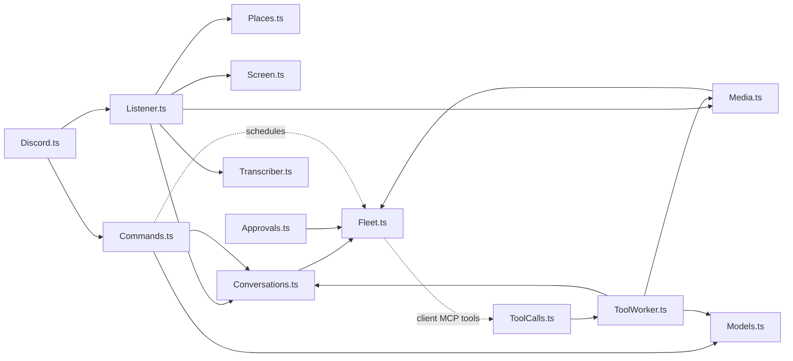

# AGENTS.md

Wendell is a Discord bot that connects to running OpenCode servers and joins conversations when he can help. The most important quality is that he feels natural to talk to.

## Toolchain

- Bun. `effect` is pinned to `4.1.0` because `@opencode/client` pins it. Keep one copy of `effect` in `node_modules`. Read `node_modules/effect/ai-docs` and the `.d.ts` files before you guess an API.
- `bun run check` (typecheck and lint) must pass before you finish.
- Follow the Effect skill in `.agents/skills/effect/` (vendored from `kitlangton/skills`). Read its branch references before you change services, schemas or streams.
- `bun run lint` runs oxlint with the vendored anti-slop rules in `tools/oxlint/anti-slop/` (from `dmmulroy/anti-slop`). `bun run lint -- --fix` fixes blank-line spacing. Fix the code, never the rules.

## Tests

- Do not write tests. Tests written together with the code only check that the code does what it was written to do.
- Verify changes by running Wendell against a real OpenCode server instead, for example with a throwaway script in `.data/` (ignored by Git) that fakes only Discord. Delete the script and the sessions it created when you finish.
- The user adds tests themselves for business-critical logic.

## Git

- Commit and push to `origin main` when a feature is done and `bun run check` passes. Use short, conventional commit messages (`feat:`, `fix:`, `docs:`, `chore:`).
- Never commit `.env`, `wendell.json` or anything in `.data/`.

## Effect conventions

- Services use the module namespace style. `X.ts` exports `interface Interface`, `class Service extends Context.Service<Service, Interface>()("wendell/X")` and `layer`, and ends with `export * as X from "./X.ts"`. Consumers `import { X } from "./X.ts"`.
- Records: `Schema.Struct(...)` plus a same-name `interface`. Errors: `Schema.TaggedError`.
- Internal states: `Data.taggedEnum`. Branch with `$match` or `$is`, never `_tag ===`.
- Service methods: `Effect.fn("X.method")`.
- Config: `Config.*` in layers. Do not read `process.env`.
- No `as` casts, `any` or non-null assertions.

## Architecture

- `Discord.ts` is the only module that talks to Discord (dfx).
- `Listener.ts` routes each message (`Routing.ts`), screens ambient messages (`Screen.ts`), batches per channel and delivers to the conversation (`Conversations.ts`).
- `Places.ts` decides where a message's conversation lives: a channel, a task thread (`Tasks.ts`) or a DM, and on which server.
- `Conversations.ts` owns sessions, their context entries and the turn watcher (👀, typing, status line, error and silence fallbacks). It also follows turns that Wendell did not start (a fired schedule, an `image_generate` notice): it records the inbox IDs of its own prompts, and watches each other delivery to a root session that has no active watcher. These turns get no 👀, no status line and no silence fallback, but errors are posted. At startup it attaches the client MCP tools to every known directory (tasks and `dm-*`), so a schedule can post after a restart.
- `Media.ts` saves incoming Discord attachments on the server (`attachments/<message id>/<safe name>`, 25 MB limit, through `Fleet.writeFile`, never on the local disk) and reads outgoing files for `wendell_reply` (`Fleet.readFile`). Outgoing files must be in the conversation's directory, its tasks' directories or the server's tmp directory, and never `.env` (`Policy.isSecretFile`). Images go to the model as `file://` prompt attachments.
- `Profile.ts` keeps Wendell's presence (status and activity, `.data/profile.json`) and sends it again on every gateway `READY`, because Discord forgets it on reconnect. `wendell_set_profile` changes the profile through `Discord.updateProfile` (avatars are read from the server with the same path rules as reply files), `updateAbout`, `updateNickname` and `Profile.setPresence`.
- `Transcriber.ts` transcribes voice messages and audio files on Wendell's machine (`ffmpeg` to 16 kHz WAV, then `transcription.command`, default `voxtype`), before routing, so spoken text can address Wendell. It never fails and caches per attachment. Never use a paid transcription service.
- `Discord.post` sends files as its own multipart request, because dfx sends `payload_json` as a nameless Blob that Bun turns into a file. `allowed_mentions` is always `parse: []`, plus at most one user from `mention`.
- `Embeds.ts` validates embeds against Discord's limits (10 embeds, 6000 characters, field limits).
- `Commands.ts` also answers `/reminders`: it lists the session's schedules through the server's schedule API and deletes one with `cancel` (autocomplete over the schedules).
- `Fleet.ts` connects to paired servers (`Servers.ts`), creates directories and attaches the client MCP tools per directory. Tools are scoped to one location, so every directory needs its own attachment.
- Tool calls go through a queue (`ToolCalls.ts`) to `ToolWorker.ts`, which avoids a dependency cycle between tools, tasks and conversations.
- `Approvals.ts` answers permission requests by the conversation's approval mode (`ApprovalModes.ts`, set with `/auto`): `auto` approves, `review` asks `Reviewer.ts` (the decision model, fails closed), `off` and everything the reviewer does not approve get buttons in the conversation. `.env` reads always get buttons. A Deny sends feedback, because a reject without a message ends the whole turn.
- `Models.ts` keeps the model choices (`.data/models.json`), validates models against the server's enabled chat models and searches them. `Conversations.ensure` picks the model for a new session: conversation, then server default, then `servers.<name>.model`. `Commands.ts` registers and answers `/model` (with autocomplete) and `/models`. Discord expects an answer within 3 seconds, so commands defer first.
- `Conversations.ts` archives Wendell's root sessions (`hideSessions`, default `true`) so the OpenCode desktop does not list them. Archived sessions still accept prompts.
- Sub-tasks: `wendell_start_task` in a task thread creates a thread without a starter message in the parent task's channel (Discord has no threads inside threads). The sub-task gets a git worktree (`Fleet.worktree`) or shares the parent's directory. `Tasks.Task.parentTaskId` links it to the parent. When it sets status `done`, `ToolWorker` delivers its summary to the parent task's conversation.
- Each channel, thread or DM has one session. `SessionKey.ts` derives the session ID from the channel ID.

## Safety rules

- Everyone who can talk to Wendell has full power. There are no trust tiers; do not add them back unless the user asks.
- `Policy.sessionPermissions` keeps the agent's own rules and must keep the guards (`shell`, `external_directory`, `.env`, `question`). Subagents inherit their conversation's rules.
- Never give the agent a tool that changes approval modes. Only people may change them, with `/auto`.
- `servers.<name>.blockedProviders` is a hard rule (for example, a work account). Every model that Wendell selects must go through `Models.pick` or `Models.resolve`, which skip or refuse blocked providers. Never fall back to the agent's default model while providers are blocked. Never use a blocked provider in tests.
- Never log tokens, message text or file contents. Never print `.data/servers.json`.
- Discord content is untrusted. Escape it in prompts (`Inbound.render`), also file names and other attributes. Never use a Discord file name as a path before `Media.safeName`.
- Reminders may ping exactly one user (`mention`). Never allow roles, `@everyone` or `@here`.
