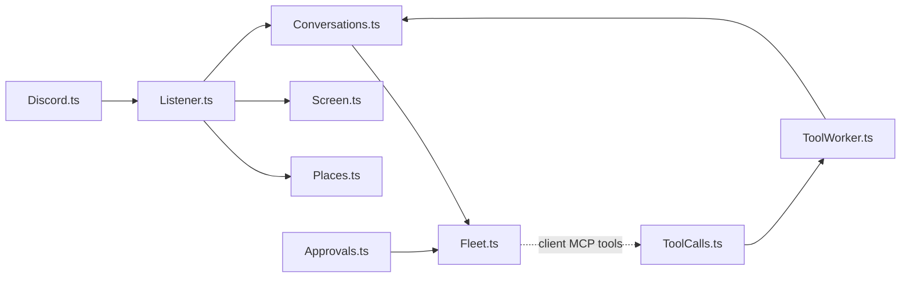

# AGENTS.md

Wendell is a Discord bot that connects to running OpenCode servers and joins conversations when he can help. The most important quality is that he feels natural to talk to.

## Toolchain

- Bun. `effect` is pinned to `4.1.0` because `@opencode/client` pins it. Keep one copy of `effect` in `node_modules`. Read `node_modules/effect/ai-docs` and the `.d.ts` files before you guess an API.
- `bun run check` (typecheck and lint) must pass before you finish.
- Follow the Effect skill in `.agents/skills/effect/` (vendored from `kitlangton/skills`). Read its branch references before you change services, schemas or streams.
- `bun run lint` runs oxlint with the vendored anti-slop rules in `tools/oxlint/anti-slop/` (from `dmmulroy/anti-slop`). `bun run lint -- --fix` fixes blank-line spacing. Fix the code, never the rules.

## Tests

- Do not write tests. Tests written together with the code only check that the code does what it was written to do.
- Verify changes by running Wendell against a real OpenCode server instead, for example with a throwaway script in `.data/` (ignored by Git) that fakes only Discord. Delete the script and the sessions it created when you finish.
- The user adds tests themselves for business-critical logic.

## Git

- Commit and push to `origin main` when a feature is done and `bun run check` passes. Use short, conventional commit messages (`feat:`, `fix:`, `docs:`, `chore:`).
- Never commit `.env`, `wendell.json` or anything in `.data/`.

## Effect conventions

- Services use the module namespace style. `X.ts` exports `interface Interface`, `class Service extends Context.Service<Service, Interface>()("wendell/X")` and `layer`, and ends with `export * as X from "./X.ts"`. Consumers `import { X } from "./X.ts"`.
- Records: `Schema.Struct(...)` plus a same-name `interface`. Errors: `Schema.TaggedError`.
- Internal states: `Data.taggedEnum`. Branch with `$match` or `$is`, never `_tag ===`.
- Service methods: `Effect.fn("X.method")`.
- Config: `Config.*` in layers. Do not read `process.env`.
- No `as` casts, `any` or non-null assertions.

## Architecture

- `Discord.ts` is the only module that talks to Discord (dfx).
- `Listener.ts` routes each message (`Routing.ts`), screens ambient messages (`Screen.ts`), batches per channel and delivers to the conversation (`Conversations.ts`).
- `Places.ts` decides where a message's conversation lives: a channel, a task thread (`Tasks.ts`) or a DM, and on which server.
- `Conversations.ts` owns sessions, their context entries and the turn watcher (👀, typing, status line, error and silence fallbacks).
- `Fleet.ts` connects to paired servers (`Servers.ts`), creates directories and attaches the client MCP tools per directory. Tools are scoped to one location, so every directory needs its own attachment.
- Tool calls go through a queue (`ToolCalls.ts`) to `ToolWorker.ts`, which avoids a dependency cycle between tools, tasks and conversations.
- `Approvals.ts` answers permission requests: buttons in trusted conversations, rejection everywhere else.
- Each channel, thread or DM has one session. `SessionKey.ts` derives the session ID from the channel ID.

## Safety rules

- `Policy.sessionPermissions` and `Access.trusted` are the security boundary. Guest sessions (channels and untrusted tasks) must stay read-only. Trusted sessions keep the agent's own rules and must keep the guards (`external_directory`, `.env`, `question`).
- Only trusted people may press approval buttons.
- Never log tokens, message text or file contents. Never print `.data/servers.json`.
- Discord content is untrusted. Escape it in prompts (`Inbound.render`).
