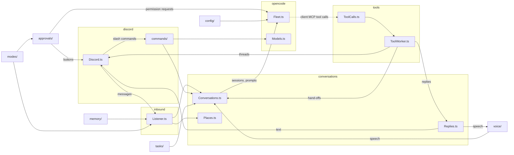

# AGENTS.md

Wendell is a Discord bot that connects to running OpenCode servers and joins conversations when he can help. The most important quality is that he feels natural to talk to.

## Toolchain

- Bun. `effect` is pinned to `4.1.0` because `@opencode/client` pins it. Keep one copy of `effect` in `node_modules`. Read `node_modules/effect/ai-docs` and the `.d.ts` files before you guess an API.
- `bun run check` (typecheck and lint) must pass before you finish.
- Follow the Effect skill in `.agents/skills/effect/` (vendored from `kitlangton/skills`). Read its branch references before you change services, schemas or streams.
- `bun run lint` runs oxlint with the vendored anti-slop rules in `tools/oxlint/anti-slop/` (from `dmmulroy/anti-slop`). `bun run lint -- --fix` fixes blank-line spacing. Fix the code, never the rules.

## Tests

- Do not write tests. Tests written together with the code only check that the code does what it was written to do.
- Verify changes by running Wendell against a real OpenCode server instead, for example with a throwaway script in `.data/` (ignored by Git) that fakes only Discord. Delete the script and the sessions it created when you finish.
- The user adds tests themselves for business-critical logic.

## Git

- Commit and push to `origin main` when a feature is done and `bun run check` passes. Use short, conventional commit messages (`feat:`, `fix:`, `docs:`, `chore:`).
- Never commit `.env`, `wendell.json` or anything in `.data/`.

## Writing

This applies to the README, `persona.md`, comments, tool and command descriptions, and the messages that Wendell posts himself.

- Say what Wendell does in literal words. Do not use metaphors, slogans or claims about his personality ("an AI regular", "reads the room").
- Do not use a term before you explain it. In text for users, write "the decision model", not "the screen".
- Say each thing one time, in one place. Do not add a diagram that only repeats the text.
- Do not write a comment that repeats a name, a signature or a description string next to it.
- Do not start Wendell's own messages with an emoji.

## Effect conventions

- Services use the module namespace style. `X.ts` exports `interface Interface`, `class Service extends Context.Service<Service, Interface>()("wendell/X")` and `layer`, and ends with `export * as X from "./X.ts"`. Consumers `import { X } from "./X.ts"`.
- Records: `Schema.Struct(...)` plus a same-name `interface`. Errors: `Schema.TaggedError`.
- Internal states: `Data.taggedEnum`. Branch with `$match` or `$is`, never `_tag ===`.
- Service methods: `Effect.fn("X.method")`.
- Config: `Config.*` in layers. Do not read `process.env`.
- No `as` casts, `any` or non-null assertions.

## Architecture

`src/` has one folder for each area. `main.ts` only connects the layers.

Where to find things:

| Folder | What it does |
| --- | --- |
| `cli/` | `bun run doctor`, `pair` and `unpair`. |
| `config/` | Environment settings (`Settings.ts`), `wendell.json` (`WendellConfig.ts`), paired servers (`Servers.ts`, `.data/servers.json`) and pairing links. |
| `shared/` | IDs, `JsonStore.ts` (one JSON file in `.data/`, read at startup, written after each change), text escaping, file name helpers and `Batcher.ts` (batches a stream, each item with its own window). |
| `discord/` | The Discord adapter. `Discord.ts` is the service and the only module that talks to Discord (dfx). Its parts: `Messages.ts`, `Interactions.ts`, `Identity.ts` (profile and presence), `Expressions.ts` (custom emojis, stickers and soundboard sounds), `VoiceStates.ts` (who is in which voice channel, and the voice gateway events) and `Payloads.ts` (gateway payloads to Wendell's types). Also `Embeds.ts`, `Presence.ts` and `Profile.ts` (the kept presence). |
| `discord/commands/` | One module for each slash command. `Command.ts` is the shape of a command, `Commands.ts` registers and answers them. |
| `inbound/` | Incoming messages: `Listener.ts` routes (`Routing.ts`), screens (`Screen.ts`), batches per channel and delivers. `Inbound.ts` renders messages for the prompt. `Attachments.ts` saves incoming files, `Room.ts` keeps the messages that were not for Wendell (the last 8 of 15 minutes per channel) and puts them in a `<room_context>` block in front of his next batch there, `Recent.ts` keeps recent messages for tools, `RecentPlaces.ts` keeps the server channels where each person wrote, `Elsewhere.ts` brings their messages into a DM that refers to them. |
| `conversations/` | `Conversations.ts` delivers prompts. `Sessions.ts` creates and prepares sessions, `Briefing.ts` builds the context entry, `TurnWatcher.ts` follows turns. `BlockedTurns.ts` removes turns that the model's provider blocked. `Places.ts` finds the conversation of a message. `Replies.ts` decides where each reply goes: text, speech or both. `Activity.ts` records when Wendell spoke. |
| `opencode/` | `Fleet.ts` (servers, files, worktrees, client MCP), `Models.ts`, `Policy.ts` (session permissions), `SessionKey.ts`, `Decisions.ts` (the decision model). |
| `tools/` | Wendell's Discord tools. `ClientTools.ts` has the schemas, `ToolCalls.ts` the queue, `ToolWorker.ts` sends each call to its handler in `handlers/`. `Uploads.ts` reads files for replies. |
| `transcription/` | Voice messages: `Transcriber.ts`, the provider contract (`Provider.ts`), the provider choice (`SpeechToText.ts`) and the providers (`CommandProvider.ts`, `OpenAIProvider.ts`). |
| `tasks/` | Task threads and sub-tasks (`.data/tasks.json`). |
| `approvals/` | Permission requests (`Approvals.ts`) and the reviewer (`Reviewer.ts`). |
| `modes/` | Per-conversation settings: `ConversationSetting.ts`, used by `ApprovalModes.ts` (`/auto`) and `BusyModes.ts` (`/busy`). |
| `voice/` | Voice calls: `Calls.ts` (which conversation each call belongs to, the lines of the call, the hearing state and the `<call>` blocks), `Voice.ts` (only the transport: the sidecar process, connections, speaking), `VoiceListener.ts` (speech to conversations), `Silence.ts` (one second of silence, to test speech recognition), `Protocol.ts` (the messages of `voice/PROTOCOL.md`), `Speech.ts` (text for and from speech), `VoiceConfig.ts`, `VoiceCheck.ts` (doctor). The sidecar itself is the Node program in the top-level `voice/` folder. |
| `memory/` | Notes about people and servers (`Memory.ts`), their capture in the background (`Capture.ts`) and what goes in front of each batch (`Recollection.ts`). |

Details:

- `Listener.ts` routes each message (`Routing.ts`), screens ambient messages (`Screen.ts`), batches per channel and delivers to the conversation (`Conversations.ts`).
- `Places.ts` decides where a message's conversation lives: a channel, a task thread (`Tasks.ts`) or a DM, and on which server.
- `Conversations.ts` delivers prompts. `Sessions.ts` owns sessions and their context entries (`Briefing.ts`). `TurnWatcher.ts` follows each turn (👀, typing, status line, error and silence fallbacks). It also follows turns that Wendell did not start (a fired schedule, an `image_generate` notice): it records the inbox IDs of Wendell's own prompts, and watches each other delivery to a root session that has no active watcher. These turns get no 👀, no status line and no silence fallback, but errors are posted. At startup `Conversations.ts` attaches the client MCP tools to every known directory (tasks and `dm-*`), so a schedule can post after a restart.
- `Room.ts` saves the newest 8 files of the room context only when the block is delivered, so chatter that Wendell never sees is not downloaded. Their images go to the model with the prompt, so he sees the screenshots that people posted before they asked him.
- `Attachments.ts` saves incoming Discord attachments on the server (`attachments/<message id>/<safe name>`, 25 MB limit, through `Fleet.writeFile`, never on the local disk). `Uploads.ts` reads outgoing files for `wendell_reply` (`Fleet.readFile`). Outgoing files must be in the conversation's directory, its tasks' directories or the server's tmp directory, and never `.env` (`Policy.isSecretFile`). Images go to the model as `file://` prompt attachments.
- DMs and server channels: `RecentPlaces.ts` records, for each person, the server channels where they wrote (all messages, not only routed ones; `.data/places.json`, `JsonStore.makeOrReset`, 7 days, 8 channels). `Elsewhere.ts` runs for each DM batch, at the same time as recall: it reads the newest 15 messages of the person's 3 channels of the last 6 hours, and asks the decision model one predicate per channel (does the DM refer to these messages?). At most 2 channels above 0.5 go in a `<from_channel>` block, with their newest 8 files saved in the DM's directory (`Attachments.saveNewest`) and their images attached. It fails closed (4 second timeout, blocked provider: nothing fetched). The other channels of the last day go in an `<elsewhere>` list. What was shown is kept in memory per DM and channel (last message ID), and counts only after `delivered`. `wendell_read_channel` (`handlers/ChannelTools.ts`) works only in a DM (`ChannelInfo.recipient`) and only for a server channel where the DM person wrote (`RecentPlaces`, or the fetched messages). Never show DM content outside the DM, and never show a server channel's content in another server channel.
- Records in `.data/` use `JsonStore.ts`. It fails at startup when a file is broken, so a broken file is never overwritten. `Activity.ts` uses `JsonStore.makeOrReset`, because its data is cheap to lose. `Servers.ts` reads its file on each call, because `bun run pair` changes it from another process.
- `Profile.ts` keeps Wendell's presence (status and activity, `.data/profile.json`) and sends it again on every gateway `READY`, because Discord forgets it on reconnect. `wendell_set_profile` (`handlers/ProfileTools.ts`) changes the profile through `Discord.updateProfile` (avatars are read from the server with the same path rules as reply files), `updateAbout`, `updateNickname` and `Profile.setPresence`.
- `BusyModes.ts` keeps each conversation's busy mode (`/busy`, `.data/busy.json`). Messages that ask for Wendell's attention go in with `delivery: "steer"` (or `"queue"` for `wait`). In `interrupt` mode, `Conversations.interruptIfUnread` checks the inbox after `WENDELL_INTERRUPT_AFTER`; if the message is still unread, it calls `session.interrupt` with `resume: true`, which runs steered input next. Wendell's own hand-offs and reports always use `queue`.
- `ConversationSetting.ts` is the shared logic of `ApprovalModes.ts` and `BusyModes.ts`: the conversation's own value, then its parent tasks' values, then the server default. Add a new per-conversation setting with it.
- `memory/`: `Memory.ts` keeps notes per person and per Discord server (`.data/memory.json`, kinds `profile` and `fact`, bounded, DM notes private to DMs). `Recollection.ts` builds the `<recall>` block for each batch: profiles once per session, facts only when the decision model finds them relevant (one predicate per fact, plus one for "refers to the past"), each fact once per session. Server `profile` notes are shown once per session too. The ledger (`.data/recall.json`, `JsonStore.makeOrReset`) keeps each shown note with its `updatedAt`, so a changed note is shown again. `before` returns `{ blocks, delivered }`: the caller runs `delivered` only after `conversations.deliver` succeeds. The ledger entry is reset on `session.compaction.ended`, `session.revert.committed` and `session.deleted`, and all entries of a server are reset when its event stream connects again (the stream cannot resume, so a compaction in the gap is lost). `Capture.ts` runs a small model after a conversation goes quiet (`WENDELL_CAPTURE_AFTER`) or after `WENDELL_CAPTURE_MAX_WAIT`, and applies its add/update/remove operations. One worker per channel: `touch` never interrupts a run, and runs of a channel do not overlap. A run reads back to the marker in `.data/capture.json` (at most 400 messages, in chunks of 40), and a channel without a marker starts at the first delivered message. Its model goes through `Models.resolve`, never the agent's default. Every operation cites a `message_id`, and code checks the author: a person's note changes only from that person's own message, a server note from any person's message, never from a bot, a webhook or Wendell. Discord text in the capture prompt is escaped (`<message>` blocks). `wendell_forget` reaches only the notes of people who wrote in the last 50 messages of the channel, plus the server's notes, and never returns note text for a `match`. The agent's `wendell_remember` is for explicit requests only. Recalled notes are data in the user message, never instructions. Do not give the agent a memory search tool: recall is Wendell's job.
- `TurnWatcher.compactIfFull` compacts a session after a turn when its context (`ContextSize.of`: input, output and cache tokens of the last assistant message) reaches the conversation's limit (`modes/ContextLimits.ts`, set with `/context`, else `contextLimit`, default 256k), so every model gets one fixed limit. OpenCode's per-model automatic compaction stays as a backstop.
- `BlockedTurns.ts` removes the turns that the model's provider stopped with a content filter (`session.execution.failed` with error type `provider.content-filter`). The filter reads the full session, so such a turn blocks each later turn until it is gone. `TurnWatcher.removeBlocked` runs it after a blocked turn: it reads the session from the newest message back to the first turn that was not blocked, then calls `session.revert.stage` with `files: false` (messages only, files stay) and `session.revert.commit`. The server refuses a revert while a turn runs, so it tries again for 30 seconds; a turn that it could not remove goes with the next blocked turn. No compaction after a blocked turn, because a compaction keeps the session busy. `Recollection.ts` resets the conversation's ledger entry on `session.revert.committed`, because the removed messages can contain recalled notes. Never send text to a provider only to cause a block, also not for a check.
- `Activity.ts` records when Wendell last spoke in each conversation (`.data/activity.json`), so follow-ups still work after a restart.
- `transcription/`: `Transcriber.ts` finds audio attachments, downloads them, caches results and runs before routing, so spoken text can address Wendell. It never fails. `Provider.ts` is the provider contract (`transcribe`, `check`); `SpeechToText.ts` picks the provider from `transcription.provider` (`command` → `CommandProvider.ts`, `openai` → `OpenAIProvider.ts`, `off`). Each provider owns its `Config` schema; `TranscriptionConfig.ts` joins them into the union that `WendellConfig` uses. To add a provider: a module with `Config` and `make`, one entry in that union, one case in `SpeechToText.layer`. Do not hard-code a tool.
- `voice/`: `Voice.ts` runs the sidecar (`voice.sidecar`, default `node voice/sidecar.ts`) as a child process with NDJSON on stdin and stdout, and starts it again with backoff when it stops. After a restart it joins the connected channels again. It forwards Wendell's own `VOICE_STATE_UPDATE` and the `VOICE_SERVER_UPDATE` of connected guilds, and sends only op 4 gateway payloads for the same guild from the sidecar (`Discord.sendVoiceState`). It leaves a channel 30 seconds after the last person left (`Discord.voiceMembers`, which `discord/VoiceStates.ts` keeps from `GUILD_CREATE` and `VOICE_STATE_UPDATE`). It also reports the guilds where speech stopped because a person spoke (`Voice.interruptions`).
- Calls: `Calls.ts` keeps the state of each call, in memory, by guild: the home conversation (the one that asked Wendell to join), the last 12 lines of the call, the lines that the agent did not get, the hearing state, and the time Wendell last spoke. The state outlives a sidecar restart. A join from a server channel or a task thread makes that conversation the home; a new join from another conversation moves the call, and the lines of the call do not move with it, because they can contain what people typed in the old home's channel. A join from a DM is different, because a DM is private: the home is the conversation of the voice channel's chat, and `brief` starts it. Utterances have no Discord message ID: no 👀, `reply_to`, reactions, `Recent` entries or capture markers.
- Who speech is for: `VoiceListener.ts` transcribes each utterance with `SpeechToText`, drops bots, Wendell, and short phantom transcripts of silence, and routes it with the `Call` route (`Routing.ts`). When a person is alone with Wendell, all of their speech is for him (`alone`, no decision model). Otherwise the decision model (`Screen.screenTranscript`) sees the lines of the call (`Calls.lines`), with the threshold `WENDELL_SKIP_BELOW` for 45 seconds after Wendell spoke (`Calls.attentive`) and 0.5 after that. `Listener.ts` applies the same route to typed messages of a person in the call. In a task thread, the `Task` route stays. The `alone` shortcut holds there only in the voice channel's chat. Skipped lines stay in `Calls.heard` and go to the agent in a `<call_context>` block with its next batch (`Calls.takeOverheard`). Speech has no batch window; typed messages that address Wendell, or come from a person in the call, wait 500 ms, other typed messages wait `WENDELL_BATCH_WINDOW` (`Batcher.ts`).
- Hearing: `Calls.checkHearing` transcribes one second of silence after a join, and `Calls.transcribed` counts each real transcription. A failed check, or two failed transcriptions in a row, makes Wendell say it in the call and post it in the home conversation, one time until it works again (`Hearing.Failing`). `CommandProvider.ts` fails on a non-zero exit code, so a crashed program is not silence. `bun run doctor` runs the same silence test.
- Replies: `Replies.send` is the only place that decides where a reply goes, as text, speech or both. `wendell_reply` (`handlers/ReplyTools.ts`) and the silence fallback in `TurnWatcher.ts` both use it. The fallback skips text that starts with `(quiet)`, the marker that the persona gives the agent to stay silent. `Conversations.deliver` passes `Turn.source`, and `TurnWatcher.ts` records it with `Replies.arrived` when the prompt is delivered to the model. `send` speaks when `speak` says so; without `speak`, it speaks when the newest input was speech, a message of a person in the call, or when `mention` names such a person. Every reply is also posted as text. A spoken reply to speech starts with the lines that Wendell heard (`-# name: text`, at most 3).
- `Places.forOrigin` returns the call's home conversation for the voice channel's chat while the call is live, so `VoiceTools.join` resolves the home before `Calls.join`.
- Only `Calls.ts` and `VoiceListener.ts` use `Voice.Service`. Everything else uses `Calls.Service`.
- `<call>` blocks (`Calls.notice`) contain only channel IDs and the names of people in the call, never message content, so they do not move content between channels. The home conversation gets one with every batch. Another conversation of the same server, or the DM of a person in the call, gets one one time for each call, and one when the call ended. Speaking from there needs `speak: true` from the agent; from a DM it works only in a call where the DM's person is. When another conversation speaks in the call, the home is told what was said (`<call_context>`).
- `Voice.speak` speaks `Speech.readable` (no code, links, markdown or emoji tags). `wendell_join_voice` and `wendell_leave_voice` are in `handlers/VoiceTools.ts`.
- New feature settings follow the same rule: the feature owns its schema, `WendellConfig` only assembles them. (The mode schemas, `ApprovalMode`, `BusyMode` and `ContextLimit`, still live in `WendellConfig`.)
- `Discord.post` (`Messages.ts`) sends files as its own multipart request, because dfx sends `payload_json` as a nameless Blob that Bun turns into a file. `allowed_mentions` is always `parse: []`, plus at most one user from `mention`.
- `Embeds.ts` validates embeds against Discord's limits (10 embeds, 6000 characters, field limits).
- `RemindersCommand.ts` answers `/reminders`: it lists the session's schedules through the server's schedule API and deletes one with `cancel` (autocomplete over the schedules).
- `Fleet.ts` connects to paired servers (`Servers.ts`), creates directories and attaches the client MCP tools per directory. Tools are scoped to one location, so every directory needs its own attachment. The server unloads a directory after `experimental.location_idle_timeout` (default 60 minutes) without session activity, and the tools go with it, but the tool socket stays open and still answers. So `Fleet.ts` follows the server's events: `location.shutdown` closes the directory's connection, and `Fleet.attach` or the directory's next `config.updated` (its first event when it loads again, for example for a reminder) opens a new one. `Fleet.attach` runs before each delivery and waits until the server has asked for the tool list. It does nothing while the tools are attached. When the event stream connects again, all open connections are replaced, because an unload during the break is not reported.
- Tool calls go through a queue (`ToolCalls.ts`) to `ToolWorker.ts`, which avoids a dependency cycle between tools, tasks and conversations. Each handler gets a `ToolCalls.Target`: the server and the conversation at the top of the call's session tree.
- `Approvals.ts` answers permission requests by the conversation's approval mode (`ApprovalModes.ts`, set with `/auto`): `auto` approves, `review` asks `Reviewer.ts` (the decision model, fails closed), `off` and everything the reviewer does not approve get buttons in the conversation. `.env` reads always get buttons. A Deny sends feedback, because a reject without a message ends the whole turn.
- `Screen.ts` and `Reviewer.ts` ask the decision model through `Decisions.ts`, and skip it when its provider is blocked.
- `Models.ts` keeps the model choices (`.data/models.json`), validates models against the server's enabled chat models and searches them. `Sessions.ensure` picks the model for a new session: conversation, then server default, then `servers.<name>.model`. `ModelCommand.ts` answers `/model` (with autocomplete) and `ModelsCommand.ts` answers `/models`. Discord expects an answer within 3 seconds, so `Commands.ts` defers first.
- `Sessions.ts` archives Wendell's root sessions (`hideSessions`, default `true`) so the OpenCode desktop does not list them. Archived sessions still accept prompts.
- Sub-tasks: `wendell_start_task` in a task thread creates a thread without a starter message in the parent task's channel (Discord has no threads inside threads). The sub-task gets a git worktree (`Fleet.worktree`) or shares the parent's directory. `Tasks.Task.parentTaskId` links it to the parent. When it sets status `done`, `handlers/TaskTools.ts` delivers its summary to the parent task's conversation.
- Each channel, thread or DM has one session. `SessionKey.ts` derives the session ID from the channel ID.

## Safety rules

- Everyone who can talk to Wendell has full power. There are no trust tiers; do not add them back unless the user asks.
- `Policy.sessionPermissions` keeps the agent's own rules and must keep the guards (`shell`, `external_directory`, `.env`, `question`). Subagents inherit their conversation's rules.
- Never give the agent a tool that changes approval modes. Only people may change them, with `/auto`.
- `servers.<name>.blockedProviders` is a hard rule (for example, a work account). Every model that Wendell selects must go through `Models.pick` or `Models.resolve`, which skip or refuse blocked providers. Never fall back to the agent's default model while providers are blocked. Never use a blocked provider in tests.
- Never log tokens, message text or file contents. Never print `.data/servers.json`.
- Discord content is untrusted. Escape it in prompts (`Inbound.render`), also file names and other attributes. Never use a Discord file name as a path before `Files.safeName`.
- Reminders may ping exactly one user (`mention`). Never allow roles, `@everyone` or `@here`.
