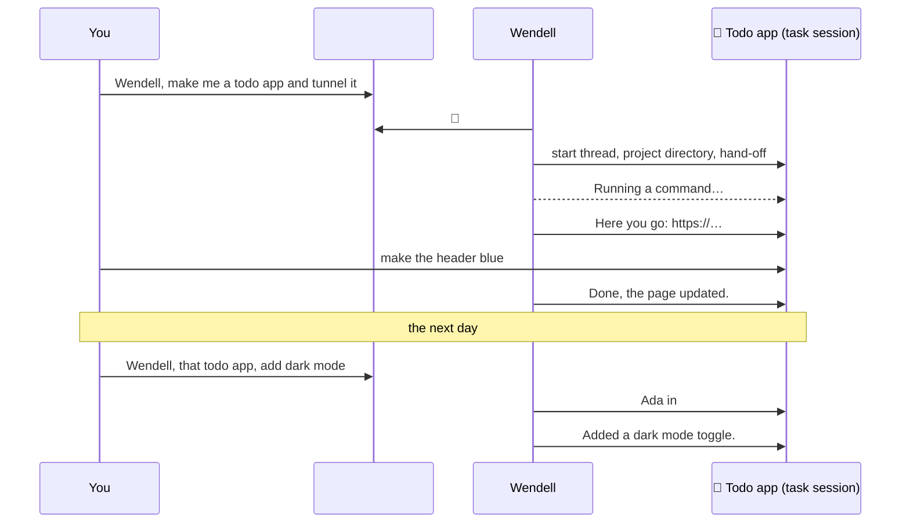
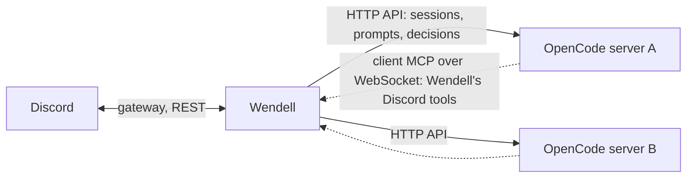

# Wendell

Wendell is a Discord bot that joins the conversation in your server. He answers when you talk to him, and he does longer work, such as a coding task, in a thread.

Wendell has no models or tools of his own. He connects to one or more running [OpenCode](https://opencode.ai) servers, for example over your tailnet, and uses the models, skills and MCP servers that you have there. He connects to Discord with [dfx](https://github.com/tim-smart/dfx). Wendell, dfx and the OpenCode client use Effect 4.

## Talking to Wendell

- To talk to him, mention him, reply to one of his messages, send him a DM, or use his name: "Wendell, …", "hey wendell …", "… right, Wendell?".
- He answers quick questions in the channel.
- He moves longer work into a thread. "Wendell, build me a todo app and put it on a tunnel" starts a thread called *Todo app* with its own project directory. In that thread, you do not need to mention him.
- He can divide large work into sub-tasks. Each sub-task gets its own thread in the same channel, with a link in the parent thread. When a sub-task is done, it reports to the parent task, and the parent continues.
- You can refer to an earlier task from any channel in the server: "Wendell, that todo app from yesterday, add dark mode". He finds the task and continues in its thread.
- You can send files, images and voice messages, also without text. See [Media](#media).
- He can remind you, and he can run a check on a schedule: "Wendell, remind me in 20 minutes to stretch", or "every weekday at 9, check that the site is up and tell me only if it is down". See [Reminders](#reminders).
- When the agent needs permission, for example for a shell command, Wendell approves the request or asks you. See [Approvals](#approvals).

Wendell also answers messages that do not address him, in two cases: in a channel that has a goal (`channels.<id>.goal` in `wendell.json`), and for `WENDELL_FOLLOW_WINDOW` (default 10 minutes) after he spoke in a conversation. A small, fast model (`WENDELL_DECISION_MODEL`, the *decision model*) first decides if such a message is for him.



### What you see while he works

- 👀 on your message: he has seen it.
- Typing: he writes an answer or does work. Typing starts immediately when the decision model expects a written answer. If he only adds a reaction, for example to "thanks", there is no typing.
- A status line such as *Running a command…*. It disappears when he answers.

For a message that does not address him, 👀 and typing appear when the decision model's score is `WENDELL_ENGAGE_ABOVE` or higher. With a lower score, they appear when he starts to work on the message.

## How it works



- Each channel, task thread and DM has one OpenCode session. Sessions use the server owner's agent, skills and MCP servers, plus Wendell's persona from `persona.md`.
- Channels work in Wendell's root directory on the server (for example `~/wendell`). Each task gets a subdirectory (`~/wendell/todo-app`). Each DM gets `~/wendell/dm-<user ID>`.
- A sub-task gets a git worktree of the parent task's repository when the parent's directory is in a git repository. The sub-task commits on its own branch, and the parent task merges it. Without a repository, the sub-task shares the parent's directory.
- Wendell attaches his Discord tools to each server through OpenCode's client MCP (see [Discord tools](#discord-tools)). You do not install anything on the server.
- The agent can post in Discord only through these tools. When someone addresses Wendell and the turn ends without a reply, Wendell posts the turn's final text.
- Some turns start without a Discord message, for example when a schedule fires or a background image is ready. Wendell posts an error if such a turn fails, but he does not post the turn's text.
- After each turn, Wendell reads the size of the session's context. When it reaches the limit (`/context limit:` for the conversation, else `contextLimit`, default 256k tokens), he tells OpenCode to compact the session. The limit is the same for every model. OpenCode's own automatic compaction stays on for models with a smaller context.
- Wendell archives his sessions, so the OpenCode desktop does not list them. Archived sessions still work. Set `hideSessions` to `false` to see them.

## Media

Files that you send to Wendell go to the OpenCode server, not to the machine that runs Wendell.

- Wendell saves each attachment in the conversation's directory, in `attachments/<message ID>/<file name>`. In the file name, he keeps only letters, digits, `.`, `-` and `_`.
- Files larger than 25 MB are not downloaded. The agent gets a note that they were skipped.
- The agent gets the name, type, size and path of each file. PNG, JPEG, GIF and WebP images also go to the model with the prompt. The model must accept images.
- The agent gets the text of a forwarded message, marked as forwarded, and its files.
- A message can contain only a file or a sticker. For example, reply to Wendell with only a screenshot.

### Voice messages

A speech-to-text provider transcribes voice messages and audio files. Set the provider with `transcription` in `wendell.json`. The default is `off`.

| `provider` | What it does | Example |
| --- | --- | --- |
| `command` | Runs a speech-to-text program on the machine that runs Wendell. `{file}` in `command` becomes the audio file, and the text comes from stdout. With `convert` (default `true`), `ffmpeg` first makes a 16 kHz mono WAV file. `ignoreLines` removes output lines that match regular expressions, such as progress messages. | `{ "provider": "command", "command": ["whisper-cli", "-m", "ggml-base.en.bin", "-nt", "-f", "{file}"] }` |
| `openai` | Sends the audio to an OpenAI-compatible `POST <url>/audio/transcriptions` endpoint. This can be a local server such as [speaches](https://github.com/speaches-ai/speaches) or LocalAI, or a hosted API. `apiKeyEnv` is the name of the environment variable that contains the key, when the endpoint needs one. `language` is an optional hint. | `{ "provider": "openai", "url": "http://localhost:8000/v1", "model": "Systran/faster-whisper-small" }` |
| `off` | No transcription. The agent gets only the audio file. | `{ "provider": "off" }` |

For [voxtype](https://github.com/peteonrails/voxtype), which prints progress lines before the text:

```json
{
  "transcription": {
    "provider": "command",
    "command": ["voxtype", "-q", "transcribe", "{file}"],
    "ignoreLines": ["^Loading audio file:", "^Audio format:", "^Processing \\d+ samples"]
  }
}
```

- The agent gets the transcript with the message. "Wendell, …" in a voice message addresses him.
- Speech recognition often gets the name "Wendell" wrong. Thus the decision model also examines voice messages that do not contain his name.
- If the transcription fails or takes more than 3 minutes, the agent gets only the audio file.
- `bun run doctor` checks the provider: that the program and `ffmpeg` exist, or that the endpoint answers.
- To add a provider, write a module in `src/transcription/` with its `Config` schema and a `make` that returns a `Provider.Provider`. Then add it to `TranscriptionConfig.Config` and `SpeechToText.layer`.

### Files and images from Wendell

- The agent attaches files with `files` in `wendell_reply`. Wendell reads them from the server and uploads them to Discord. A message can have at most 10 files, 20 MB for each file and 25 MB in total.
- Wendell sends only files from the conversation's directory, the directories of its tasks, and the server's temporary directory (for example `/tmp/opencode`). He never sends `.env` files.
- For structured results, the agent can add `embeds`. An embed image can show an attached file with `attachment://<file name>`.
- To make an image, the agent uses OpenCode's `image_generate` tool. The server must have an enabled image model, and before OpenCode 2.2.2 also `experimental.image_generate` in its config. Wendell looks for the tool when he connects, and again when the server's config, models or providers change. Without the tool, he tells people that he cannot make images on that server. The tool runs in the background, and the agent posts the image when it is ready.

## Voice calls

Wendell can join a voice channel in a Discord server. He hears what people say there and speaks his replies.

- Ask him to join, for example "Wendell, join my call". The agent calls `wendell_join_voice` with your user ID, or with a voice channel ID.
- A Discord voice channel has its own text chat with the same ID. The call and this chat are one conversation. When you ask Wendell to join from another channel, he continues in the voice channel's chat.
- Each thing that a person says goes to the speech-to-text provider of [Voice messages](#voice-messages). Wendell ignores bots. "Wendell, …" at the start or end addresses him. The decision model examines all other speech, because Wendell takes part in the call and speech recognition often gets his name wrong. Speech of a few seconds goes to the agent in one batch, as for messages.
- The agent gets the speech marked as speech recognition, with the speaker's name and user ID. Speech has no message ID, so Wendell does not react to it, reply to it or show 👀.
- When Wendell is in the call, he speaks his replies in the voice channel's conversation instead of posting them. He removes code blocks, links, markdown and emojis before he speaks, and says names for mentions. He also posts the reply in the chat when it has files, embeds, links, code or a mention, or when nothing readable remains.
- When someone talks while Wendell speaks, he stops speaking.
- He leaves when you ask (`wendell_leave_voice`), or 30 seconds after the last person leaves the channel.
- Discord bots cannot join DM calls or group calls.
- Wendell cannot tell people from bots when someone talks over him: any speech stops his speech.

### Set up voice

1. Turn on transcription (see [Voice messages](#voice-messages)). Without it, Wendell can speak in a call but does not hear it.
2. Run a speech server with an OpenAI-compatible `POST /v1/audio/speech` endpoint that streams raw PCM (24 kHz, mono, 16-bit) and a `GET /health` endpoint, on the machine that runs Wendell.
3. Install the voice sidecar, a Node.js 24 program that makes the voice connections:

   ```sh
   cd voice && npm ci
   ```

4. Add `voice` to `wendell.json`. Voice is on when this key is present. All fields are optional:

   ```json
   {
     "voice": {
       "tts": { "url": "http://127.0.0.1:8880", "voice": "verity" },
       "vad": { "silenceMs": 700, "minSpeechMs": 400, "maxUtteranceMs": 15000 }
     }
   }
   ```

   | Field | Meaning |
   | --- | --- |
   | `tts.url` | Base URL of the speech server. Default: `http://127.0.0.1:8880`. |
   | `tts.voice` | Voice of the speech server. Default: `verity`. |
   | `vad.silenceMs` | Silence that ends one thing that a person says. Default: `700`. |
   | `vad.minSpeechMs` | Shorter speech is ignored. Default: `400`. |
   | `vad.maxUtteranceMs` | Longer speech is cut into parts. Default: `15000`. |
   | `sidecar` | The command that starts the sidecar, from the repository root. Default: `["node", "voice/sidecar.ts"]`. |

5. Give Wendell's role the **Connect** and **Speak** permissions in the voice channels. Wendell uses the voice states intent, which is not privileged, so the Developer Portal needs no change.
6. Run `bun run doctor`. It checks that `node` runs, that `voice/node_modules` exists and that the speech server answers on `/health`.

Wendell starts the sidecar as a child process and starts it again when it stops. The sidecar does not get the bot token: Wendell sends the voice events of the Discord gateway to it. `voice/PROTOCOL.md` describes the messages between them.

## Memory

Wendell keeps short notes about people and about each Discord server. The agent gets only the notes that apply to the current messages.

### Notes

- A *profile* note tells the agent how to treat someone ("prefers short answers"). A *fact* is something about a person or a server ("plays OSRS").
- Notes about a person apply in every Discord server where Wendell is. Notes about a server apply only in that server. Notes from a DM apply only in DMs with that person.
- Each person and each server has at most 40 notes and 4000 characters.
- `/memory` shows the notes about you and this server. `/memory forget:<note>` removes a note. You can see and remove only your own notes and the server's notes.
- The notes are in `.data/memory.json`. Wendell uses no external memory service.

### When the agent gets a note

- The agent gets the profile notes of a person with that person's next message, and the profile notes of the server ("keep answers short here") with the next batch of messages.
- For facts, the decision model answers one yes or no question for each fact about the server and about the people in the batch. The agent gets at most 3 facts that clearly apply. When a message refers to earlier conversations ("remember my setup?"), the agent gets at most 6 facts, and the threshold is lower. If the decision model fails, the agent gets no facts.
- The agent gets each note one time in a session. It gets the note again after the note changes, after the session is compacted or deleted, and after Wendell connects to the OpenCode server again. `.data/recall.json` records which notes each conversation has received.
- With the notes, the agent gets these rules: use a note only when it helps with the current messages, do not say that you remember, and do not mention personal things in a shared channel.
- The agent also gets up to 8 messages from the last 15 minutes that were not for Wendell, with his next turn in that channel. Thus he knows the subject of the conversation when someone addresses him.

### How notes are made

- When a conversation has been quiet for `WENDELL_CAPTURE_AFTER` (default 10 minutes), a small model (`memory.captureModel`) reads the new messages and the current notes. It adds, changes or removes notes. A conversation that does not go quiet is read after `WENDELL_CAPTURE_MAX_WAIT` (default 1 hour).
- The agent itself saves a note only when someone asks ("remember that …").
- To stop the background capture, set `memory.capture` to `"off"`.
- Capture starts at the first message that Wendell got in a conversation. It does not read older history. `.data/capture.json` records the last message that it read.
- One run reads at most the 400 newest unread messages, in groups of at most 40. If there are more, Wendell skips the older messages and writes a warning to the log.
- Each change must refer to the message that it comes from. Wendell accepts a change to a note about a person only when that person wrote the message. He accepts a change to a server note from a message of any person.
- Messages from other bots and webhooks cannot change a note, and Wendell keeps no notes about them.
- Capture needs a model that the server offers. Without one, capture does not run, and Wendell writes one warning to the log.

## Reminders

Wendell uses OpenCode's schedules (`experimental.schedules: true` in your OpenCode config). The agent creates a schedule in the conversation's session with `schedule_create`. When the schedule fires, the session gets the schedule's prompt as a new turn, and the agent posts in the conversation.

- A schedule fires once (`in 20 minutes`, or at a time), at an interval (`every 1 hour`) or on a cron (`0 9 * * 1-5`).
- Times use `WENDELL_TIME_ZONE` (default: the time zone of the machine that runs Wendell), unless you name another time zone.
- A reminder pings only the person who asked. The agent sets `mention` in `wendell_reply`, and Discord allows only that user. Wendell never pings roles, `@everyone` or `@here`.
- If you ask for a check that reports only problems, Wendell posts nothing when the check finds no problem.
- A schedule can post after a restart of Wendell. It can also post after OpenCode unloads a directory that had no session activity for 60 minutes (`experimental.location_idle_timeout`). In each case, Wendell attaches his tools again.
- `/reminders` shows the reminders of the current conversation with their next run. `/reminders cancel:<name>` cancels one. Type a part of the name to select it.
- Commands in a check still need approval (see [Approvals](#approvals)). In `review` mode, the reviewer approves what clearly follows from the conversation. Otherwise, buttons appear and the check waits for a person.

## Discord tools

The agent can post in Discord only through these tools.

| Tool | Use |
| --- | --- |
| `wendell_reply` | Post a message. Fields: `text` (required), `reply_to` (a message ID), `files` (paths on the server), `embeds` (Discord embeds, at most 10 and 6000 characters together), `mention` (one user ID to ping). |
| `wendell_react` | Add an emoji reaction to a message. Custom emojis use `name:id`. |
| `wendell_start_task` | Move longer work into a thread, or start a sub-task. |
| `wendell_continue_task` | Send a request to an existing task. |
| `wendell_update_task` | Record the summary and status of a task. |
| `wendell_set_model` | Change the model of the conversation or the server default. |
| `wendell_remember` | Only when someone asks: keep a note about a person (`about: "person"`, `user_id`) or this server (`about: "server"`). Fields: `text`, `replaces` (a note ID to update), `expires` (a date), `message_id`. |
| `wendell_forget` | Remove a note by `id`, or by `match` (words from the note). Both reach only the notes about people who wrote in the last 50 messages of the conversation (not Wendell or other bots), and the notes about this server. The words must match exactly one note. |
| `wendell_set_profile` | Change Wendell's Discord profile: `username`, `avatar` and `banner` (image paths on the server, or `null` to remove), `about` ("About me"), `nickname` (in this Discord server), `status` (`online`, `idle`, `dnd`, `invisible`) and `activity` (`{ "type": "listening", "text": "the rain" }`, or `custom` for a custom status). Wendell keeps the status and activity in `.data/profile.json` and sets them again after each reconnect. Discord limits username and avatar changes to about 2 per hour. |
| `wendell_add_expression` | Add a custom emoji, a sticker or a soundboard sound to the Discord server of the conversation. Fields: `kind` (`emoji`, `sticker` or `sound`), `name`, `file` (a path on the server, with the same rules as reply files), `emoji` (required for a sticker, optional for a sound), `description` (sticker) and `volume` (sound, 0 to 1). |
| `wendell_list_expressions` | List the custom emojis, stickers and soundboard sounds of the Discord server, with IDs and who added them. Field: `kind` (optional). |
| `wendell_edit_expression` | Change an emoji (`name`), a sticker (`name`, `emoji`, `description`) or a sound (`name`, `emoji`, `volume`). `expression` is the ID or the exact name. |
| `wendell_remove_expression` | Remove an emoji, a sticker or a sound. `expression` is the ID or the exact name. |
| `wendell_join_voice` | Join a voice channel of the Discord server: the channel of `user_id`, or `channel_id`. See [Voice calls](#voice-calls). |
| `wendell_leave_voice` | Leave the voice channel of the Discord server. |

With the Create Expressions permission, Wendell can add emojis, stickers and sounds, and change or remove the ones he added. To change or remove the ones that other people added, give his role the Manage Expressions permission too.

## Slash commands

| Command | What it does |
| --- | --- |
| `/model` | Change the model of this conversation, or the server default with `scope`. |
| `/models` | Show the model of this conversation and the server default. |
| `/auto` | Show or set the approval mode of this conversation. |
| `/busy` | Show or set what happens when you message Wendell while he works. `interrupt` (default): he reads the message at his next step. If he has not read it after 15 seconds, Wendell interrupts the current step. `steer`: he reads it at his next step, without an interrupt. `wait`: he reads it after he finishes. |
| `/context` | Show this conversation's context size and limit. `limit:<size>` (for example `256k`, `200000` or `off`) sets the limit for this conversation. Sub-tasks use their parent's limit. `compact:now` compacts the conversation immediately. |
| `/memory` | Show the notes about you and this server, or remove a note with `forget`. |
| `/reminders` | Show the reminders of this conversation, or cancel one with `cancel`. |

Only you see the answers of `/models`, `/memory` and `/reminders`. The same is true for `/auto`, `/busy` and `/context` when they only show a value.

Wendell registers the slash commands in each Discord server when he starts. For a new Discord server, restart Wendell.

## Models

Each conversation can use a different model. There are two ways to change it:

- Ask Wendell: "Wendell, use Opus here". He calls `wendell_set_model`.
- Use the slash command `/model`. Type a part of the name, then select a model from the list. Set `scope` to *server default* to change the model for new conversations on that server.

Wendell selects the model for a new session in this order. He skips models of `blockedProviders`:

1. The model of the conversation, from `/model` or `wendell_set_model`.
2. The server default, from `/model` with *server default*.
3. `servers.<name>.model` in `wendell.json`.
4. The default model of the agent. Wendell does not use it when the server has blocked providers.

Wendell records these choices in `.data/models.json`, so they stay after a restart. A change of the server default applies only to new conversations.

## Approvals

Every shell command, every path outside Wendell's directory and every `.env` read needs approval. The shell runs with your full user rights, and OpenCode checks only the shell's working directory, not the paths in the command. Set how Wendell answers these requests with `/auto`, for each conversation:

| Mode | What happens |
| --- | --- |
| `review` (default) | The decision model reads the request with the conversation. It approves what clearly follows from the request. The rest gets buttons. If the review fails or times out, you get buttons. |
| `auto` | Wendell approves every request. |
| `off` | Every request gets **Allow once**, **Always allow** and **Deny** buttons. |

- Reading `.env` files, directly or in a shell command, always gets buttons.
- `/auto` without a mode shows the current mode. Sub-tasks use their parent task's mode until someone sets their own.
- Wendell has no tool to change the mode, so a message or a web page cannot turn on `auto`.
- Approved shell commands show only in the log. Other approvals post a short note.
- **Deny** tells the agent to continue without the request.

## Safety

Wendell runs on your machine with your tools. **Everyone who can talk to him can use all of them**: edits, commands, subagents, dev servers and tunnels. This includes everyone in the Discord servers that he is in, and everyone who shares a server with him, because they can DM him. Add Wendell only to servers where everyone may use your machine.

- Your agent's own permission rules still apply, including your `deny` rules.
- Paths outside Wendell's directory and `.env` files need an approval button. Anyone in the conversation can press it.
- Subagents use the rules of the conversation that started them, and their approval requests appear in that conversation.
- To allow more tools without approval, add actions to `servers.<name>.allow`. MCP tool actions are `<server>_<tool>`, so `"browse_*"` allows the browse MCP.

Give Wendell a directory of his own on each server, such as `~/wendell`. Do not use your home directory.

## Set up

1. Install the dependencies:

   ```sh
   bun install
   ```

2. Create a Discord application in the [Developer Portal](https://discord.com/developers/applications):
   - On **Bot**, click **Reset Token** and copy the token. Turn on **Message Content Intent**.
   - On **OAuth2 → URL Generator**, select the `bot` scope and these permissions: View Channels, Send Messages, Send Messages in Threads, Create Public Threads, Read Message History, Add Reactions, Embed Links, Attach Files, Create Expressions, and for [voice calls](#voice-calls) Connect and Speak. Open the generated URL to add the bot to your server.
   - In Discord, turn on **Settings → Advanced → Developer Mode**. You can then right-click a server, channel, role or user and select **Copy ID**.

3. Copy `.env.example` to `.env` and set `DISCORD_BOT_TOKEN`.

4. On each OpenCode machine, make the server reachable from the machine that runs Wendell, then create Wendell's directory. For a tailnet:

   ```sh
   opencode service set hostname 0.0.0.0   # or the machine's tailnet IP
   opencode service start
   mkdir -p ~/wendell
   opencode pair --url http://<tailnet-name-or-ip>:49374
   ```

5. Pair Wendell with the printed link before it expires (5 minutes, one use):

   ```sh
   bun run pair home http://<tailnet-name-or-ip>:49374/auth/connect/<code> /home/<you>/wendell
   ```

   Repeat for more servers with other names. The token goes into `.data/servers.json` with mode `600`. It lasts 30 days. Pair again when `bun run doctor` reports that the token expired. Remove a server with `bun run unpair <name>`.

6. Copy `wendell.example.json` to `wendell.json`. Set a model per server, and optionally channel goals.

7. Check the setup, then start Wendell:

   ```sh
   bun run doctor
   bun start
   ```

8. To keep Wendell running, make him a systemd user service. Create `~/.config/systemd/user/wendell.service`:

   ```ini
   [Unit]
   Description=Wendell Discord bot
   After=default.target network-online.target
   StartLimitIntervalSec=0

   [Service]
   Type=simple
   WorkingDirectory=/path/to/wendell
   ExecStart=/path/to/bun src/main.ts
   Restart=always
   RestartSec=10
   NoNewPrivileges=yes
   EnvironmentFile=/path/to/wendell/.env

   [Install]
   WantedBy=default.target
   ```

   Then start it, and read the log with `journalctl`:

   ```sh
   systemctl --user daemon-reload
   systemctl --user enable --now wendell
   journalctl --user -u wendell -f
   ```

   For a service that starts without a login, run `loginctl enable-linger $USER` once. After you change the code, `persona.md` or `wendell.json`, run `systemctl --user restart wendell`.

## wendell.json

| Field | Meaning |
| --- | --- |
| `defaultServer` | OpenCode server for channels without a `server`. Default: the first paired server. |
| `memory.capture` | `"background"` (default) or `"off"`. See [Memory](#memory). |
| `memory.captureModel` | Model for background capture, as `provider/model` or `provider/model#variant`. Default: the server's default model (set with `/model`, else `servers.<name>.model`). The server must offer the model, and its provider must not be blocked. If no such model is set, capture does not run. Use a small model. |
| `transcription` | The speech-to-text provider for voice messages: `command`, `openai` or `off` (default). See [Media](#media). |
| `voice` | Voice calls. Off when the key is not present. See [Set up voice](#set-up-voice). |
| `contextLimit` | Context size in tokens at which Wendell compacts a session, for every model. Default: `256000`. `0` leaves compaction to OpenCode alone. |
| `servers.<name>.contextLimit` | The same, for one server. |
| `hideSessions` | Archive Wendell's sessions, so the OpenCode desktop does not list them. Default: `true`. With `false`, Wendell does not archive or unarchive sessions. |
| `servers.<name>.agent` | Agent for Wendell's sessions. Default: the server's default agent. |
| `servers.<name>.model` | Model as `provider/model`, with an optional `#variant`. Use a fast model, because people wait for the answer in chat. `/model` can override it (see [Models](#models)). |
| `servers.<name>.blockedProviders` | Provider IDs that Wendell must never use on this server, for example `["anthropic"]` for a work account. Wendell skips their models when he selects a model, refuses them in `/model` and `wendell_set_model`, and moves existing sessions off them. With blocked providers, set `servers.<name>.model`, because the agent's default could use a blocked provider. Subagents with their own model in the OpenCode config ignore this rule; `bun run doctor` warns about them. |
| `servers.<name>.allow` | Permission actions that need no approval, such as `"browse_*"`. Shell commands always go through approvals. |
| `servers.<name>.busy` | Busy mode for conversations without their own: `"interrupt"` (default), `"steer"` or `"wait"`. |
| `servers.<name>.approvals` | Approval mode for conversations without their own: `"review"` (default), `"auto"` or `"off"`. |
| `channels.<id>.server` | OpenCode server for this channel. |
| `channels.<id>.goal.wakeWhen` | Which messages Wendell answers in this channel when nobody addresses him. |
| `channels.<id>.goal.engagement` | How Wendell answers. |

Threads use the server and goal of their parent channel. Task threads stay on the server where they started. Sub-tasks use the server of their parent task.

## Tune

| To change | Edit |
| --- | --- |
| How Wendell writes, and his rules | `persona.md` |
| Which messages Wendell answers when nobody addresses him | `goal.wakeWhen` in `wendell.json` |
| The decision model's score below which Wendell ignores a message that does not address him | `WENDELL_SKIP_BELOW` (default `0.2`, keep it low) |
| How long a message waits before it interrupts Wendell (`/busy interrupt`) | `WENDELL_INTERRUPT_AFTER` (default `15 seconds`) |
| The score from which 👀 and typing show immediately for a message that does not address him | `WENDELL_ENGAGE_ABOVE` (default `0.8`) |
| How long a conversation must be quiet before background capture reads it | `WENDELL_CAPTURE_AFTER` (default `10 minutes`) |
| The longest time that background capture waits in a conversation that does not go quiet | `WENDELL_CAPTURE_MAX_WAIT` (default `1 hour`) |
| The score from which the reviewer approves a request | `WENDELL_APPROVE_ABOVE` (default `0.6`) |
| How permission requests are answered here | `/auto` |
| How long Wendell follows a conversation after he speaks | `WENDELL_FOLLOW_WINDOW` (default `10 minutes`) |
| How long Wendell collects messages before he delivers them together | `WENDELL_BATCH_WINDOW` (default `3 seconds`) |
| The time zone for reminders | `WENDELL_TIME_ZONE` (default: the machine's time zone) |
| The model of one conversation, or of a server | `/model`, or ask Wendell |

Changes to `persona.md`, `model` and `allow` reach existing sessions after a restart. Tasks are recorded in `.data/tasks.json`, model choices in `.data/models.json`, approval modes in `.data/approvals.json`.

## Development

```sh
bun run check
```

The code is in `src/`, with one folder for each area. `src/main.ts` connects the parts. `AGENTS.md` describes the folders, the conventions and the architecture.
