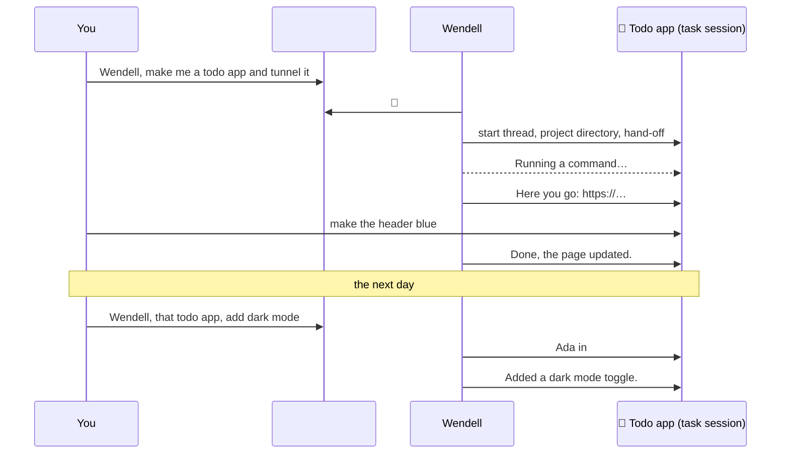
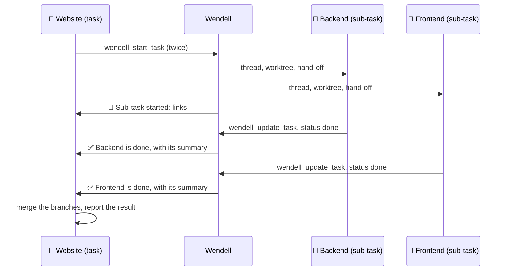
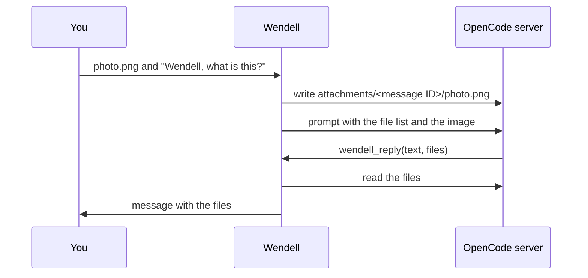
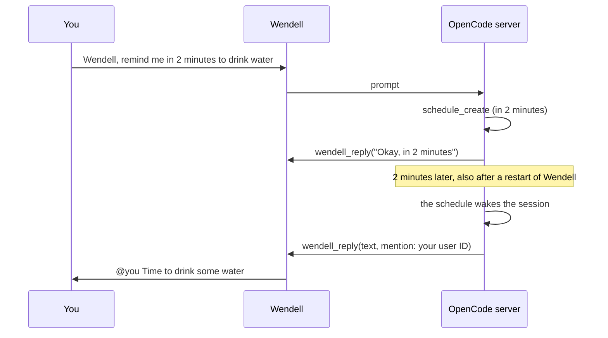

# Wendell

Wendell is an AI regular in your Discord server. He reads the room, answers when you talk to him, and takes on real work in threads.

Wendell has no AI setup of his own. He connects to one or more running [OpenCode](https://opencode.ai) servers, for example over your tailnet. There he works with your models, skills and MCP servers. He connects to Discord with [dfx](https://github.com/tim-smart/dfx). Both sides are built on Effect 4.

## Talking to Wendell

- **Address him** with a mention, a reply to one of his messages, a DM, or just his name: "Wendell, …", "hey wendell …", "… right, Wendell?".
- **Quick questions** get an answer in the channel.
- **Real work** moves into a thread. "Wendell, build me a todo app and put it on a tunnel" starts a thread called *Todo app* with its own project directory. Everything said in that thread goes to that task, without a mention.
- **Large work** splits into **sub-tasks**. In a task thread, Wendell can start a sub-task for an independent part of the work. Each sub-task gets its own thread in the same channel, with a link in the parent thread. When a sub-task is done, it reports to the parent task, and the parent continues.
- **Later**, refer back from anywhere in the server: "Wendell, that todo app from yesterday, add dark mode". He finds the task and continues in its thread.
- **Files and images**: send them with your message, also without text. Wendell sees images and can read other files. See [Media](#media).
- **Reminders and check-ins**: "Wendell, remind me in 20 minutes to stretch", or "every weekday at 9, check that the site is up and tell me only if it is down". See [Reminders](#reminders).
- **While he works**, you see 👀 on your message, typing, and a status line such as *Running a command…*. The status line disappears when he answers.
- **Approvals**: when the agent needs permission (for example for a shell command, or to read outside its project directory), Wendell checks the conversation's approval mode. See [Approvals](#approvals).
- He also joins in **without being addressed** in channels with a goal, and shortly after he has spoken in a conversation. A cheap decision model screens these messages first.





## How it works


- Each channel, task thread and DM has one OpenCode session. Sessions use the server owner's agent, skills and MCP servers, plus Wendell's persona from `persona.md`.
- Wendell archives his sessions, so the OpenCode desktop does not list them. Archived sessions still work. Set `hideSessions` to `false` to see them.
- Channels work in Wendell's root directory on the server (for example `~/wendell`). Each task gets a subdirectory (`~/wendell/todo-app`). Each DM gets `~/wendell/dm-<user ID>`.
- A sub-task gets a git worktree of the parent task's repository when the parent's directory is in a git repository. The sub-task commits on its own branch, and the parent task merges it. Without a repository, the sub-task shares the parent's directory.
- Wendell attaches his Discord tools to each server through OpenCode's client MCP (see [Discord tools](#discord-tools)). You do not install anything on the server.
- The agent speaks only through these tools. When someone addresses Wendell and the turn ends without a reply, Wendell posts the turn's final text.
- Some turns start without a Discord message, for example when a schedule fires or a background image is ready. Wendell follows these turns too. He posts an error if one fails, but he does not post the turn's text.

## Media

Files that you send to Wendell go to the OpenCode server, not to the machine that runs Wendell.

- Wendell saves each attachment in the conversation's directory, in `attachments/<message ID>/<file name>`. He makes the file name safe first (letters, digits, `.`, `-` and `_`).
- Files larger than 25 MB are not downloaded. The message tells the agent that they were skipped.
- The agent gets the name, type, size and path of each file. PNG, JPEG, GIF and WebP images also go to the model with the prompt, so it sees them. The model must accept images.
- Forwarded messages work too. The agent gets the forwarded text, marked as forwarded, and the forwarded files and images like other attachments.
- Messages with only a file or a sticker work like other messages. For example, reply to Wendell with only a screenshot.

Voice messages and audio files are transcribed on the machine that runs Wendell, without a paid service:

- Wendell converts the audio to a 16 kHz mono WAV file with `ffmpeg`, then runs a local speech-to-text command. The default is [voxtype](https://github.com/peteonrails/voxtype) (`voxtype -q transcribe {file}`), which uses Whisper on your machine.
- The transcript goes to the agent with the message, and routing uses it. So "Wendell, …" in a voice message addresses him.
- Speech recognition often mishears "Wendell". So a voice message without his name still goes to the screen, which knows about the problem, instead of being ignored.
- If the transcription fails or takes more than 3 minutes, the agent gets only the audio file.
- To use another tool, set `transcription.command`. To turn it off, set `transcription.enabled` to `false`. `bun run doctor` checks that the commands exist.

Wendell can also send files:

- The agent attaches files with `files` in `wendell_reply`. Wendell reads them from the server and uploads them to Discord. A message can have at most 10 files, 20 MB for each file and 25 MB in total.
- Wendell sends only files from the conversation's directory, the directories of its tasks, and the server's temporary directory (for example `/tmp/opencode`). He never sends `.env` files.
- For structured results, the agent can add `embeds`. An embed image can show an attached file with `attachment://<file name>`.
- When you ask for an image, the agent uses OpenCode's `image_generate` tool (`experimental.image_generate` in your OpenCode config). The tool runs in the background. When the image is ready, the agent posts it.



## Reminders

Wendell uses OpenCode's schedules (`experimental.schedules: true` in your OpenCode config). The agent creates a schedule in the conversation's session with `schedule_create`. When it fires, the session gets the schedule's prompt as a new turn, and the agent posts in the conversation.

- A schedule fires once (`in 20 minutes`, or at a time), at an interval (`every 1 hour`) or on a cron (`0 9 * * 1-5`).
- Times use `WENDELL_TIME_ZONE` (default `America/New_York`), unless you name another time zone.
- A reminder pings only the person who asked. The agent sets `mention` in `wendell_reply`, and Discord allows only that user. Wendell never pings roles, `@everyone` or `@here`.
- A check that reports only problems stays silent when everything is fine.
- Wendell attaches his tools to all known conversations when he starts, so a schedule can post after a restart.
- `/reminders` shows the reminders of the current conversation with their next run. Only you see the answer. `/reminders cancel:<name>` cancels one; type a part of the name to select it.
- Commands in a check still need approval (see [Approvals](#approvals)). In `review` mode, the reviewer approves what clearly follows from the conversation. Otherwise, buttons appear and the check waits for a person.



## Discord tools

The agent speaks only through these tools.

| Tool | Use |
| --- | --- |
| `wendell_reply` | Post a message. Fields: `text` (required), `reply_to` (a message ID), `files` (paths on the server), `embeds` (Discord embeds, at most 10 and 6000 characters together), `mention` (one user ID to ping). |
| `wendell_react` | Add an emoji reaction to a message. |
| `wendell_start_task` | Move real work into a thread, or start a sub-task. |
| `wendell_continue_task` | Send a request to an existing task. |
| `wendell_update_task` | Record the summary and status of a task. |
| `wendell_set_model` | Change the model of the conversation or the server default. |
| `wendell_set_profile` | Change Wendell's Discord profile: `username`, `avatar` and `banner` (image paths on the server, or `null` to remove), `about` ("About me"), `nickname` (in this Discord server), `status` (`online`, `idle`, `dnd`, `invisible`) and `activity` (`{ "type": "listening", "text": "the rain" }`, or `custom` for a custom status). Wendell keeps the status and activity in `.data/profile.json` and sets them again after each reconnect. Discord limits username and avatar changes to about 2 per hour. |

## Slash commands

| Command | What it does |
| --- | --- |
| `/model` | Change the model of this conversation, or the server default with `scope`. |
| `/models` | Show the model of this conversation and the server default. Only you see the answer. |
| `/auto` | Show or set the approval mode of this conversation. |
| `/reminders` | Show the reminders of this conversation, or cancel one with `cancel`. Only you see the answer. |

## Models

Each conversation can use a different model. Change it in two ways:

- Ask Wendell: "Wendell, use Opus here". He calls `wendell_set_model`.
- Use the slash command `/model`. Type a part of the name, then select a model from the list. Set `scope` to *server default* to change the model for new conversations on that server.

`/models` shows the model of the current conversation and the server default. Only you see the answer.

Wendell selects the model for a new session in this order. He skips models of `blockedProviders`:

1. The model of the conversation, from `/model` or `wendell_set_model`.
2. The server default, from `/model` with *server default*.
3. `servers.<name>.model` in `wendell.json`.
4. The default model of the agent. Wendell does not use it when the server has blocked providers.

Wendell records these choices in `.data/models.json`, so they stay after a restart. A change of the server default applies only to new conversations. Wendell registers the slash commands in each Discord server when he starts. For a new Discord server, restart Wendell.

## Approvals

Every shell command, every path outside Wendell's directory and every `.env` read needs approval. The shell runs with your full user rights, and OpenCode checks only the shell's working directory, not the paths in the command. Choose how Wendell answers with `/auto`, for each conversation:

| Mode | What happens |
| --- | --- |
| `review` (default) | The decision model reads the request with the conversation. It approves what clearly follows from the request. The rest gets buttons. If the review fails or times out, you get buttons. |
| `auto` | Wendell approves every request. |
| `off` | Every request gets **Allow once**, **Always allow** and **Deny** buttons. |

- Reading `.env` files, directly or in a shell command, always gets buttons.
- `/auto` without a mode shows the current mode. Sub-tasks use their parent task's mode until someone sets their own.
- Wendell has no tool to change the mode, so a message or a web page cannot turn on `auto`.
- Approved shell commands show only in the log. Other approvals post a short note.
- **Deny** tells the agent to continue without the request.

## Safety

Wendell runs on your machine with your tools. **Everyone who can talk to him has full power**: edits, commands, subagents, dev servers and tunnels. This includes everyone in the Discord servers that he is in, and everyone who shares a server with him, because they can DM him. Add Wendell only to servers where everyone may use your machine.

- Your agent's own permission rules still apply, including your `deny` rules.
- Paths outside Wendell's directory and `.env` files need an approval button. Anyone in the conversation can press it.
- Subagents use the rules of the conversation that started them, and their approval requests appear in that conversation.
- To allow more tools without approval, add actions to `servers.<name>.allow`. MCP tool actions are `<server>_<tool>`, so `"browse_*"` allows the browse MCP.

Give Wendell a directory of his own on each server, such as `~/wendell`. Do not use your home directory.

## Set up

1. Install the dependencies:

   ```sh
   bun install
   ```

2. Create a Discord application in the [Developer Portal](https://discord.com/developers/applications):
   - On **Bot**, click **Reset Token** and copy the token. Turn on **Message Content Intent**.
   - On **OAuth2 → URL Generator**, select the `bot` scope and these permissions: View Channels, Send Messages, Send Messages in Threads, Create Public Threads, Read Message History, Add Reactions, Embed Links, Attach Files. Open the generated URL to add the bot to your server.
   - In Discord, turn on **Settings → Advanced → Developer Mode**. You can then right-click a server, channel, role or user and select **Copy ID**.

3. Copy `.env.example` to `.env` and set `DISCORD_BOT_TOKEN`.

4. On each OpenCode machine, make the server reachable from the machine that runs Wendell, then create Wendell's directory. For a tailnet:

   ```sh
   opencode service set hostname 0.0.0.0   # or the machine's tailnet IP
   opencode service start
   mkdir -p ~/wendell
   opencode pair --url http://<tailnet-name-or-ip>:49374
   ```

5. Pair Wendell with the printed link before it expires (5 minutes, one use):

   ```sh
   bun run pair omarchy http://<tailnet-name-or-ip>:49374/auth/connect/<code> /home/<you>/wendell
   ```

   Repeat for more servers with other names. The token goes into `.data/servers.json` with mode `600`. It lasts 30 days. Pair again when `bun run doctor` reports that the token expired. Remove a server with `bun run unpair <name>`.

6. Copy `wendell.example.json` to `wendell.json`. Set a model per server, and optionally channel goals.

7. Check the setup, then start Wendell:

   ```sh
   bun run doctor
   bun start
   ```

8. To keep Wendell running, make him a systemd user service. Create `~/.config/systemd/user/wendell.service`:

   ```ini
   [Unit]
   Description=Wendell Discord bot
   After=default.target network-online.target
   StartLimitIntervalSec=0

   [Service]
   Type=simple
   WorkingDirectory=/path/to/wendell
   ExecStart=/path/to/bun src/main.ts
   Restart=always
   RestartSec=10
   NoNewPrivileges=yes
   EnvironmentFile=/path/to/wendell/.env

   [Install]
   WantedBy=default.target
   ```

   Then start it, and read the log with `journalctl`:

   ```sh
   systemctl --user daemon-reload
   systemctl --user enable --now wendell
   journalctl --user -u wendell -f
   ```

   For a service that starts without a login, run `loginctl enable-linger $USER` once. After you change the code, `persona.md` or `wendell.json`, run `systemctl --user restart wendell`.

## wendell.json

| Field | Meaning |
| --- | --- |
| `defaultServer` | OpenCode server for channels without a `server`. Default: the first paired server. |
| `transcription.command` | Local speech-to-text command for voice messages. `{file}` becomes a 16 kHz mono WAV file. The text comes from stdout. Default: `["voxtype", "-q", "transcribe", "{file}"]`. Needs `ffmpeg`. |
| `transcription.enabled` | Set to `false` to turn off transcription. Default: `true`. |
| `hideSessions` | Archive Wendell's sessions, so the OpenCode desktop does not list them. Default: `true`. With `false`, Wendell does not archive or unarchive sessions. |
| `servers.<name>.agent` | Agent for Wendell's sessions. Default: the server's default agent. |
| `servers.<name>.model` | Model as `provider/model`, with an optional `#variant`. Pick a fast one, because chat should feel quick. `/model` can override it (see [Models](#models)). |
| `servers.<name>.blockedProviders` | Provider IDs that Wendell must never use on this server, for example `["anthropic"]` for a work account. Wendell skips their models when he selects a model, refuses them in `/model` and `wendell_set_model`, and moves existing sessions off them. With blocked providers, set `servers.<name>.model`, because the agent's default could use a blocked provider. Subagents with their own model in the OpenCode config ignore this rule; `bun run doctor` warns about them. |
| `servers.<name>.allow` | Permission actions that need no approval, such as `"browse_*"`. Shell commands always go through approvals. |
| `servers.<name>.approvals` | Approval mode for conversations without their own: `"review"` (default), `"auto"` or `"off"`. |
| `channels.<id>.server` | OpenCode server for this channel. |
| `channels.<id>.goal.wakeWhen` | What Wendell listens for without being addressed. |
| `channels.<id>.goal.engagement` | How Wendell answers. |

Threads use the server and goal of their parent channel. Task threads stay on the server where they started. Sub-tasks use the server of their parent task.

## Tune

| To change | Edit |
| --- | --- |
| Wendell's voice and rules | `persona.md` |
| What Wendell listens for | `goal.wakeWhen` in `wendell.json` |
| How many ambient messages the screen removes | `WENDELL_SKIP_BELOW` (keep it low) |
| How sure the reviewer must be to approve a request | `WENDELL_APPROVE_ABOVE` (default `0.6`) |
| How permission requests are answered here | `/auto` |
| How long Wendell follows a conversation after he speaks | `WENDELL_FOLLOW_WINDOW` |
| How long Wendell waits to batch messages | `WENDELL_BATCH_WINDOW` |
| The time zone for reminders | `WENDELL_TIME_ZONE` (default `America/New_York`) |
| The model of one conversation, or of a server | `/model`, or ask Wendell |

Changes to `persona.md`, `model` and `allow` reach existing sessions after a restart. Tasks are recorded in `.data/tasks.json`, model choices in `.data/models.json`, approval modes in `.data/approvals.json`.

## Development

```sh
bun run check
```

`AGENTS.md` describes the conventions for coding agents.
