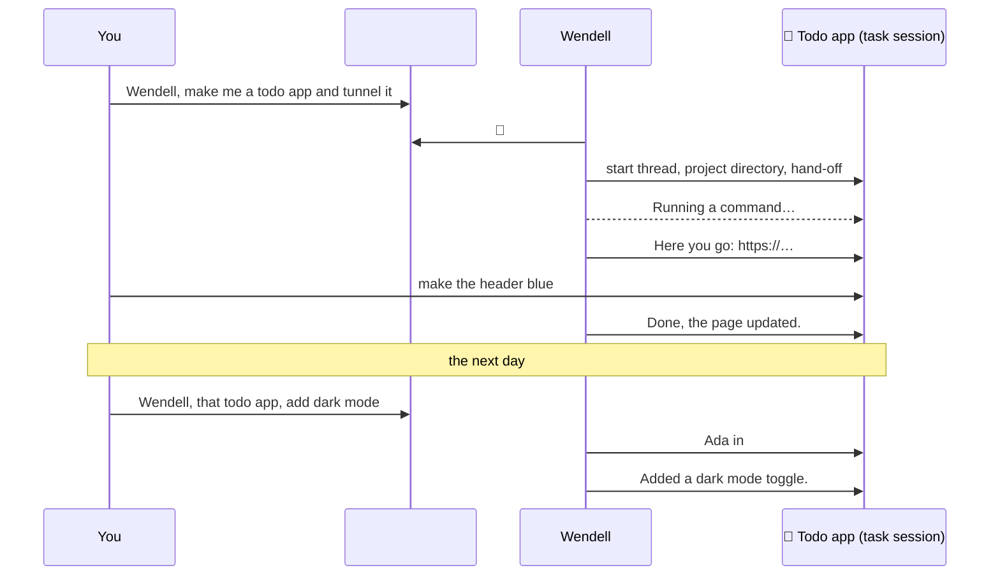
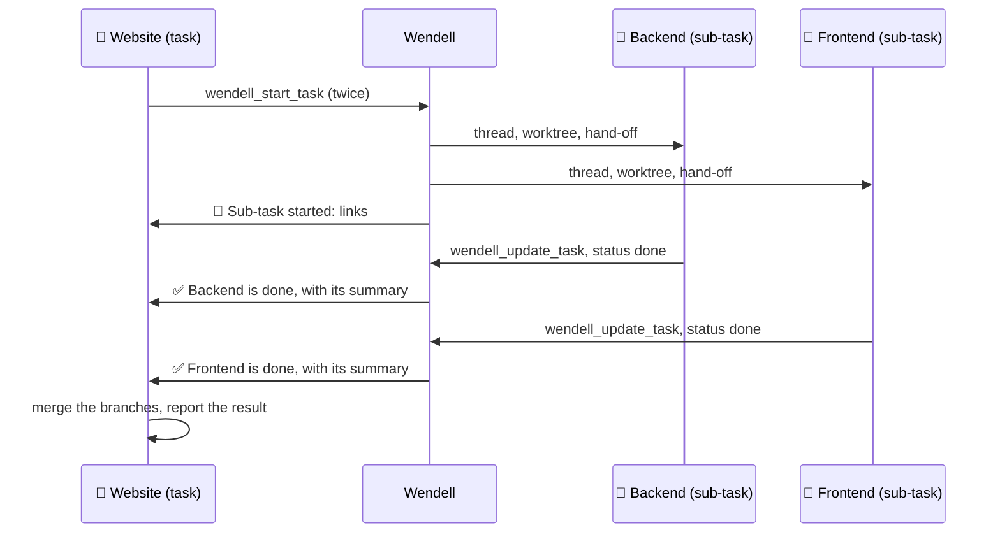

# Wendell

Wendell is an AI regular in your Discord server. He reads the room, answers when you talk to him, and takes on real work in threads.

Wendell has no AI setup of his own. He connects to one or more running [OpenCode](https://opencode.ai) servers, for example over your tailnet. There he works with your models, skills and MCP servers. He connects to Discord with [dfx](https://github.com/tim-smart/dfx). Both sides are built on Effect 4.

## Talking to Wendell

- **Address him** with a mention, a reply to one of his messages, a DM, or just his name: "Wendell, …", "hey wendell …", "… right, Wendell?".
- **Quick questions** get an answer in the channel.
- **Real work** moves into a thread. "Wendell, build me a todo app and put it on a tunnel" starts a thread called *Todo app* with its own project directory. Everything said in that thread goes to that task, without a mention.
- **Large work** splits into **sub-tasks**. In a task thread, Wendell can start a sub-task for an independent part of the work. Each sub-task gets its own thread in the same channel, with a link in the parent thread. When a sub-task is done, it reports to the parent task, and the parent continues.
- **Later**, refer back from anywhere in the server: "Wendell, that todo app from yesterday, add dark mode". He finds the task and continues in its thread.
- **While he works**, you see 👀 on your message, typing, and a status line such as *Running a command…*. The status line disappears when he answers.
- **Approvals**: when the agent needs permission (for example to read outside its project directory), Wendell posts **Allow once**, **Always allow** and **Deny** buttons in the thread.
- He also joins in **without being addressed** in channels with a goal, and shortly after he has spoken in a conversation. A cheap decision model screens these messages first.





## How it works


- Each channel, task thread and DM has one OpenCode session. Sessions use the server owner's agent, skills and MCP servers, plus Wendell's persona from `persona.md`.
- Wendell archives his sessions, so the OpenCode desktop does not list them. Archived sessions still work. Set `hideSessions` to `false` to see them.
- Channels work in Wendell's root directory on the server (for example `~/wendell`). Each task gets a subdirectory (`~/wendell/todo-app`). Each DM gets `~/wendell/dm-<user ID>`.
- A sub-task gets a git worktree of the parent task's repository when the parent's directory is in a git repository. The sub-task commits on its own branch, and the parent task merges it. Without a repository, the sub-task shares the parent's directory. A sub-task has the same access as its parent task.
- Wendell attaches his Discord tools to each server through OpenCode's client MCP: `wendell_reply`, `wendell_react`, `wendell_start_task`, `wendell_continue_task`, `wendell_update_task` and `wendell_set_model`. You do not install anything on the server.
- The agent speaks only through these tools. When someone addresses Wendell and the turn ends without a reply, Wendell posts the turn's final text.

## Models

Each conversation can use a different model. A trusted person can change it in two ways:

- Ask Wendell: "Wendell, use Opus here". He calls `wendell_set_model`.
- Use the slash command `/model`. Type a part of the name, then select a model from the list. Set `scope` to *server default* to change the model for new conversations on that server.

`/models` shows the model of the current conversation and the server default. Only you see the answer.

Wendell selects the model for a new session in this order. He skips models of `blockedProviders`:

1. The model of the conversation, from `/model` or `wendell_set_model`.
2. The server default, from `/model` with *server default*.
3. `servers.<name>.model` in `wendell.json`.
4. The default model of the agent. Wendell does not use it when the server has blocked providers.

Wendell records these choices in `.data/models.json`, so they stay after a restart. A change of the server default applies only to new conversations. Wendell registers the slash commands in each Discord server when he starts. For a new Discord server, restart Wendell.

## Access and safety

Wendell runs on your machine with your tools, so the access rules matter.

| Who | Where | What the agent can do |
| --- | --- | --- |
| Trusted people | Channels where everyone is trusted, their task threads, their DMs | Everything the server's agent allows: edits, commands, subagents, dev servers, tunnels. Paths outside Wendell's directory and `.env` files need an approval button. |
| Everyone else | Channels with restricted access, their task threads, their DMs | Read inside Wendell's directory, search the web, use skills and Code Mode. Everything else is rejected. |

A channel session is shared by everyone in the channel, so it gets full power only when everyone in that Discord server is trusted. Subagents inherit the rules of the conversation that started them, and their approval requests appear in that conversation.

Who is trusted:

- By default, **everyone** is trusted: in every server, and in DMs. This fits servers where everyone may use your machine.
- Set `defaultAccess`, or `guilds.<server ID>.access`, to `"administrators"` (the server owner and roles with Administrator) or `{ "role": "<role ID>" }`.
- `owners` are trusted everywhere, including DMs, whatever the access rules say.

Only trusted people can press approval buttons. For trusted sessions, your agent's own permission rules still apply, including your `deny` rules. To let everyone use more tools in channels, add actions to `servers.<name>.allow`. MCP tool actions are `<server>_<tool>`, so `"browse_*"` allows the browse MCP.

Give Wendell a directory of his own on each server, such as `~/wendell`. Do not use your home directory.

## Set up

1. Install the dependencies:

   ```sh
   bun install
   ```

2. Create a Discord application in the [Developer Portal](https://discord.com/developers/applications):
   - On **Bot**, click **Reset Token** and copy the token. Turn on **Message Content Intent**.
   - On **OAuth2 → URL Generator**, select the `bot` scope and these permissions: View Channels, Send Messages, Send Messages in Threads, Create Public Threads, Read Message History, Add Reactions, Embed Links, Attach Files. Open the generated URL to add the bot to your server.
   - In Discord, turn on **Settings → Advanced → Developer Mode**. You can then right-click a server, channel, role or user and select **Copy ID**.

3. Copy `.env.example` to `.env` and set `DISCORD_BOT_TOKEN`.

4. On each OpenCode machine, make the server reachable from the machine that runs Wendell, then create Wendell's directory. For a tailnet:

   ```sh
   opencode service set hostname 0.0.0.0   # or the machine's tailnet IP
   opencode service start
   mkdir -p ~/wendell
   opencode pair --url http://<tailnet-name-or-ip>:49374
   ```

5. Pair Wendell with the printed link before it expires (5 minutes, one use):

   ```sh
   bun run pair omarchy http://<tailnet-name-or-ip>:49374/auth/connect/<code> /home/<you>/wendell
   ```

   Repeat for more servers with other names. The token goes into `.data/servers.json` with mode `600`. It lasts 30 days. Pair again when `bun run doctor` reports that the token expired. Remove a server with `bun run unpair <name>`.

6. Copy `wendell.example.json` to `wendell.json`. Set yourself as an owner, a model per server, and optionally access rules and channel goals.

7. Check the setup, then start Wendell:

   ```sh
   bun run doctor
   bun start
   ```

## wendell.json

| Field | Meaning |
| --- | --- |
| `owners` | Discord user IDs that are trusted everywhere, whatever the access rules say. |
| `defaultAccess` | Who is trusted in servers without their own rule, and in DMs: `"everyone"` (default), `"administrators"` or `{ "role": "<role ID>" }`. With a restricted default, only owners are trusted in DMs. |
| `guilds.<server ID>.access` | The same, for one Discord server. |
| `defaultServer` | OpenCode server for channels without a `server`. Default: the first paired server. |
| `hideSessions` | Archive Wendell's sessions, so the OpenCode desktop does not list them. Default: `true`. With `false`, Wendell does not archive or unarchive sessions. |
| `servers.<name>.agent` | Agent for Wendell's sessions. Default: the server's default agent. |
| `servers.<name>.model` | Model as `provider/model`, with an optional `#variant`. Pick a fast one, because chat should feel quick. `/model` can override it (see [Models](#models)). |
| `servers.<name>.blockedProviders` | Provider IDs that Wendell must never use on this server, for example `["anthropic"]` for a work account. Wendell skips their models when he selects a model, refuses them in `/model` and `wendell_set_model`, and moves existing sessions off them. With blocked providers, set `servers.<name>.model`, because the agent's default could use a blocked provider. Subagents with their own model in the OpenCode config ignore this rule; `bun run doctor` warns about them. |
| `servers.<name>.allow` | Extra permission actions for channels and untrusted tasks, such as `"browse_*"`. |
| `channels.<id>.server` | OpenCode server for this channel. |
| `channels.<id>.goal.wakeWhen` | What Wendell listens for without being addressed. |
| `channels.<id>.goal.engagement` | How Wendell answers. |

Threads use the server and goal of their parent channel. Task threads stay on the server where they started. Sub-tasks use the server of their parent task.

## Tune

| To change | Edit |
| --- | --- |
| Wendell's voice and rules | `persona.md` |
| What Wendell listens for | `goal.wakeWhen` in `wendell.json` |
| Who has full power | `owners`, `defaultAccess`, `guilds` |
| How many ambient messages the screen removes | `WENDELL_SKIP_BELOW` (keep it low) |
| How long Wendell follows a conversation after he speaks | `WENDELL_FOLLOW_WINDOW` |
| How long Wendell waits to batch messages | `WENDELL_BATCH_WINDOW` |
| The model of one conversation, or of a server | `/model`, or ask Wendell |

Changes to `persona.md`, `model` and `allow` reach existing sessions after a restart. Tasks are recorded in `.data/tasks.json`, model choices in `.data/models.json`.

## Development

```sh
bun run check
```

`AGENTS.md` describes the conventions for coding agents.
